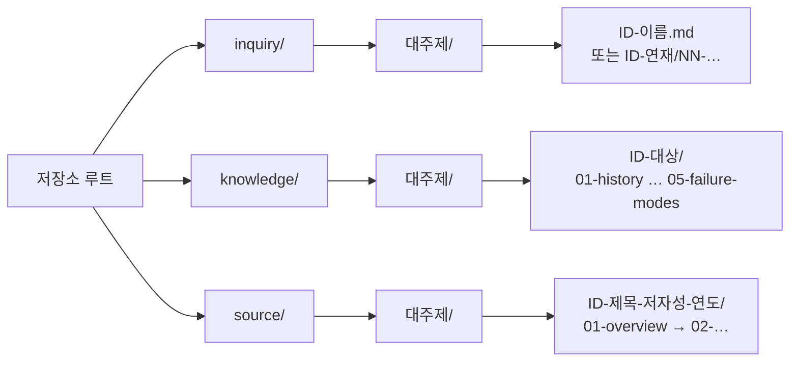
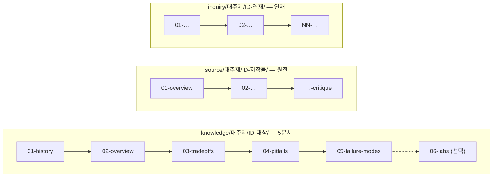

# 저장소 구조 (Architecture)

이 저장소의 **폴더 구조와 나누는 기준**을 정의하는 문서. 폴더 규칙의 원문은 이 문서이고, [`CLAUDE.md`](./CLAUDE.md)는 이 문서를 불러와 쓴다.

- 문서 유형의 정의·구성·frontmatter → [CLAUDE.md — 문서 유형](./CLAUDE.md#문서-유형)
- knowledge 5문서의 내용 → [CLAUDE.md — knowledge 5문서 구성](./CLAUDE.md#knowledge-5문서-구성)
- 원전 분석의 frontmatter·연결 → [CLAUDE.md — 원전 분석](./CLAUDE.md#원전-분석-source)
- 대주제 목록 → [CLAUDE.md — 대주제 맵](./CLAUDE.md#대주제-맵)

## 1. 폴더 구조

루트는 **유형 폴더 3개**로 나누고, 그 아래를 **대주제**로 나눈다. 모든 답변 문서의 경로는 `<유형>/<대주제>/<ID>-<이름>.md`이고, 순서가 있는 묶음만 묶음 폴더가 한 단 더 붙는다.

```
inquiry/                          질문 단위 문서 (대부분의 문서)
└── <대주제>/
    ├── <ID>-<이름>.md
    └── <ID>-<연재>/NN-….md        순서대로 읽는 연재 (예: LLM 아키텍처)
knowledge/                        5문서 세트만
└── <대주제>/<ID>-<대상>/
    └── 01-history.md … 05-failure-modes.md (+ 선택: 06-labs.md)
source/                           저작물 자체의 분석
└── <대주제>/<ID>-<제목>-<저자성>-<연도>/
    └── 01-overview.md → 02-….md
```



예:
- `inquiry/database/0003-mysql-gap-lock-next-key-lock-mechanism-and-terms.md`
- `inquiry/ai/0002-llm-architecture/02-tokenizer.md`
- `knowledge/database/0002-redis/01-history.md`
- `source/distributed-systems/0001-the-log-kreps-2013/01-overview.md`

루트의 `README.md`, `CLAUDE.md`, `ARCHITECTURE.md`는 저장소 안내 문서이고, `site/`는 `knowledge/`를 GitHub Pages 사이트로 만드는 빌드 도구이고, `.github/workflows/`는 그 배포 워크플로다. 이것들은 모두 이 구조의 대상이 아니다.

유형을 맨 위에 둔 이유:
- 유형마다 만드는 때와 구성이 다르다. inquiry는 질문 하나에 문서 하나, knowledge와 source는 순서대로 읽는 묶음이다.
- 문서 하나를 저장할 때 판단할 것이 **유형과 대주제 두 가지**뿐이다.
- 저장소가 커지면 유형 폴더 단위로 분리하기 쉽다.

## 2. 층별로 나누는 기준

한 폴더 안에서는 **한 기준으로만** 나눈다.

| 층 | 나누는 기준 | 들어가는 것 | 두지 않는 것 |
|---|---|---|---|
| 루트 | 문서 유형 | `inquiry/`, `knowledge/`, `source/` | 답변 파일 |
| 1. 대주제 | 관심 분야 | 문서, 묶음 폴더 (모두 ID가 붙는다) | 그 외 폴더 |
| 2. 묶음 | 읽는 순서 | `NN-` 문서 | 폴더 |

- **유형 폴더**: frontmatter `type`과 같아야 한다. 판정은 3절.
- **대주제**: 넓은 관심 분야. 세 유형 폴더 모두 **같은 대주제 이름**을 쓴다. 그 유형의 문서가 처음 생길 때 만들고, 빈 폴더는 만들지 않는다. 새 대주제는 기존 어디에도 맞지 않을 때만 만든다.
- **묶음 폴더**: 순서대로 읽는 문서 묶음만 폴더로 만든다 (5절). 주제별 하위 분류용 폴더는 만들지 않는다.
- **이름**: 폴더명과 파일명은 kebab-case. ID 뒤의 이름은 질문 내용을 요약해 짓고, 대상 이름을 앞에 둔다 (예: `0001-kafka-consumer-mechanism.md`).

## 3. 유형 판정

유형은 만드는 때로 정한다 — 질문하면 inquiry, 세트를 지시하면 knowledge, 원전 분석을 지시하면 source. 자세한 내용은 [CLAUDE.md — 문서 유형](./CLAUDE.md#문서-유형).

## 4. 대주제 결정

- 문서가 다루는 **관심 분야** 하나로 대주제를 정한다. 여러 분야에 걸치면 주된 쪽 하나를 고른다.
- 한 번 저장한 문서의 경로는 바뀌지 않는다.
- 새 대주제를 만들거나 기존 대주제의 범위가 바뀌면 [CLAUDE.md 대주제 맵](./CLAUDE.md#대주제-맵)에 반영한다.

## 5. 번호: ID(4자리)와 순서(2자리)

파일명·폴더명 앞의 번호는 **자릿수로 뜻을 나눈다.**

| 자릿수 | 뜻 | 붙이는 곳 | 예 |
|---|---|---|---|
| 4자리 `NNNN-` | **식별자(ID)** — 순서와 무관, 바뀌지 않음 | 대주제 바로 아래의 모든 문서와 묶음 폴더 | `0002-kafka-overview.md`, `0002-redis/` |
| 2자리 `NN-` | **읽는 순서** | 묶음 폴더 안의 문서 | `01-history.md`, `02-tokenizer.md` |

### ID 규칙

- **유형 폴더 안의 대주제 폴더마다 따로** 번호를 매긴다 (예: `inquiry/ai/`와 `inquiry/web/`는 각각 0001부터). 다른 폴더와 번호가 겹쳐도 된다 — 문서를 가리킬 때는 폴더와 함께 부른다 (예: `inquiry/ai/0012`).
- 새 문서·묶음의 ID는 **그 폴더 안 최대 ID + 1**이다. 묶음은 폴더에 ID 하나를 붙이고, 안의 문서에는 ID를 붙이지 않는다.
- 한 번 붙인 ID는 바꾸지 않고, 문서를 지워도 그 번호는 다시 쓰지 않는다. 빈 번호는 그대로 둔다.
- ID는 파일명이 원본이다. frontmatter에 따로 적지 않는다.
- 0001부터 시작한다.

### 순서 규칙



| 묶음 | 위치 | 내용 규칙 |
|---|---|---|
| knowledge 5문서 | `knowledge/<대주제>/<ID>-<대상>/01-history` ~ `05-failure-modes`, 선택 `06-labs` | [CLAUDE.md — knowledge 5문서 구성](./CLAUDE.md#knowledge-5문서-구성) |
| 원전 분석 | `source/<대주제>/<ID>-<제목>-<저자성>-<연도>/01-overview` → `02-…` | [CLAUDE.md — 원전 분석](./CLAUDE.md#원전-분석-source) |
| 연재 | `inquiry/<대주제>/<ID>-<연재>/01-…` | — |

- 순서는 `01-`부터 시작한다. `00-`은 쓰지 않는다. 안내 문서가 필요하면 그것이 `01-`이 된다.
- 묶음 폴더 안에는 그 묶음의 문서만 둔다. 묶음과 관련된 단독 질문(예: 연재의 FAQ)은 묶음 폴더 밖, 같은 대주제에 자기 ID로 둔다.
