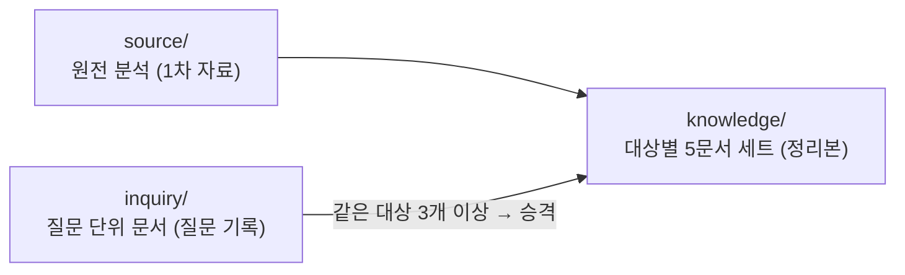

# knowledge

기술·개념 하나를 **역사 → 개요 → 트레이드오프 → 흔한 함정 → 장애 유형** 다섯 문서로 정리한 [`knowledge/`](./knowledge/) 세트를 만드는 저장소. 나머지 폴더는 그 세트를 만드는 데 쓰는 **질문 기록·1차 자료**다. 질문 하나에 답한 inquiry가 같은 대상으로 3개 이상 쌓이면 knowledge 세트로 승격한다.

저장 규칙은 [`CLAUDE.md`](./CLAUDE.md), 폴더 구조와 도식은 [`ARCHITECTURE.md`](./ARCHITECTURE.md) 참고.

## 폴더 구조

루트를 문서 유형 3개로 나누고, 그 아래를 대주제로 나눈다. 경로는 `<유형>/<대주제>/<ID>-<이름>.md`이고, 순서대로 읽는 묶음(5문서 세트, 원전, 연재)만 폴더가 한 단 더 붙는다.

| 폴더 | 역할 | 담는 것 | 관리 |
|---|---|---|---|
| [`knowledge/`](./knowledge/) | **정리본** | 대상 하나의 5문서 세트 (역사 → 개요 → 트레이드오프 → 흔한 함정 → 장애 유형) | 세트를 완성·갱신한다 |
| [`inquiry/`](./inquiry/) | 질문 기록 | 질문 단위 문서 — 개념 설명, 비교·판단, 원인 분석, 방법, 목록·수치·현황 조사 | 쌓기만 하고, 쌓이면 승격한다. `verified`가 있는 문서는 재확인한다 |
| [`source/`](./source/) | 1차 자료 | 논문·에세이·책 같은 저작물 자체의 분석 | 원전 목록과 함께 갱신한다 |

**번호**: 4자리(`0012-`)는 폴더 안에서 매기는 문서 ID이고 순서와 무관하다. 2자리(`01-`)는 묶음 폴더 안에서 읽는 순서다.

예: `inquiry/database/0012-mysql-gap-lock-when.md`, `knowledge/database/0002-redis/01-history.md`

## 문서 유형

판정 순서: 저작물 자체의 분석이면 `source` → 5문서 세트의 하나면 `knowledge` → 그 외는 `inquiry`.

- **inquiry·knowledge·source**: **쉬운 설명**(그 문서의 질문 하나에 대한 비유, 1~3문장) → **일반 설명**(전문 용어 포함 상세)
- 목록·수치·가격·현황이 중심인 inquiry는 **한 줄 결론**(답을 1~3줄로, 비유 없음) → 표·목록 중심 본문 → 출처
- frontmatter: `type`, `created`, `verified`(시간이 지나면 틀리는 내용을 마지막으로 확인한 날짜, 선택), `author`(`agent` | `human`), `model`(에이전트가 쓴 경우 모델 ID)

**knowledge 5문서**: 솔루션이나 큰 개념 자체를 물어보면 `knowledge/<대주제>/<ID>-<대상>/`에 5개를 모두 쓴다. 해당 없는 단계도 파일을 만들고 이유를 한 줄 남긴다.

1. `01-history.md` — 역사
2. `02-overview.md` — 개요·기본 사용법
3. `03-tradeoffs.md` — 얻은 것과 포기한 것, 대안 비교, 구성 선택
4. `04-pitfalls.md` — 사람이 잘못 쓰는 것: 흔한 실수와 해결
5. `05-failure-modes.md` — 장애 유형(원인이 대상): 장애·복구·고가용성, 적용 한계·반례

**승격 규칙**: 같은 개념·솔루션을 다루는 inquiry가 3개 이상 쌓이면, 확인을 거쳐 그 대상의 5문서 세트를 만들고 기존 inquiry에서 링크한다.

## 원전 목록

| 원전 | 위치 | linked |
|---|---|---|
| Jay Kreps, *The Log* (2013) | [`source/distributed-systems/0001-the-log-kreps-2013/`](./source/distributed-systems/0001-the-log-kreps-2013/01-overview.md) | Kafka·고가용성 6개(`inquiry/distributed-systems/0003·0005~0009`), ClickHouse·컬럼 지향 DB(`inquiry/database/0009·0013`), 1급 개념(`inquiry/cs/0006`) — 전체 목록은 `01-overview.md`의 `linked` |

## 대주제

`ai`, `game-ai`, `database`, `distributed-systems`, `web`, `infra`, `cs`, `languages`, `software-engineering`, `dev-tools`, `security`, `external-apis`, `study-and-career` — 각 대주제가 다루는 범위는 [CLAUDE.md — 대주제 맵](./CLAUDE.md#대주제-맵).

> 루트의 `nginx/`는 답변 아카이브가 아니라 실제 nginx 설정 파일(`nginx.conf`, `default.conf`) 디렉터리.
