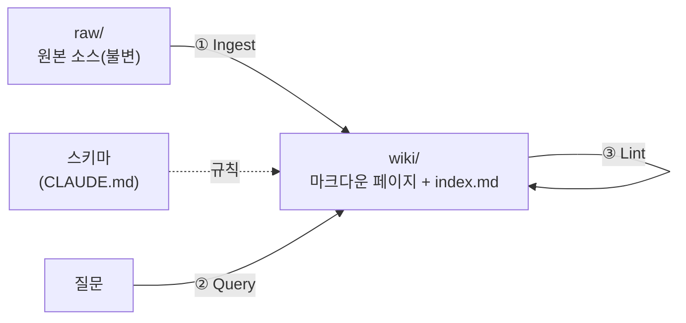

# LLM Wiki (Karpathy 패턴): RAG 대신 LLM이 직접 가꾸는 위키

## 쉬운 설명

RAG는 질문할 때마다 **책 더미를 뒤져서** 필요한 쪽을 찾아 읽는 방식이다. LLM Wiki는 **똑똑한 사서가 책을 읽을 때마다 정리 노트(위키)를 계속 고쳐 써 두는** 방식이다. 질문이 오면 원본 책 더미가 아니라 이미 정리된 노트를 읽는다. 책이 늘수록 노트가 더 풍성해진다.

## 일반 설명

### 1. 정의

**LLM Wiki**는 Andrej Karpathy가 2026년 4월경 공개한 지식 관리 패턴이다(검색된 자료 기준). 원본 문서를 매번 검색해 답하는 대신, **LLM 에이전트가 마크다운 파일 묶음(위키)을 점진적으로 구축·유지보수**하고, 질문은 이 위키를 읽어 답한다.

- 위키에는 엔티티 페이지, 개념 페이지, 출처 요약, 모순 표시, 상호 참조(링크)가 들어간다.
- 핵심 아이디어: 지식을 **질의 시점이 아니라 수집(ingest) 시점에 "컴파일"** 해서 누적한다. 그래서 "compiled knowledge"라고도 부른다.
- 위키 서비스(MediaWiki, Confluence)를 뜻하는 말이 아니다. 사람이 쓰는 위키를 LLM이 대신 쓰고 관리한다는 의미다.

### 2. 3계층 구조

| 계층 | 내용 | 규칙 |
|---|---|---|
| **raw/** | 원본 소스(논문, 기사, 회의록, 문서) | **불변(immutable).** LLM은 읽기만 하고 수정하지 않음 |
| **wiki/** | LLM이 생성·갱신하는 마크다운 페이지 | `index.md`(목차/카탈로그), 개념·엔티티·요약 페이지, 링크 |
| **스키마 (`CLAUDE.md` 등)** | 위키 구조·작성 규칙·워크플로 지침 | LLM이 지켜야 할 "편집 규정집". 사람과 LLM이 함께 다듬음 |

### 3. 핵심 동작 3가지

| 동작 | 설명 |
|---|---|
| **Ingest(수집)** | 새 소스를 읽고 요약 페이지를 만들고, 관련 기존 페이지(개념·엔티티)를 갱신하며, 교차 링크와 `index.md`를 업데이트. 기존 내용과 **충돌하면 모순으로 표시** |
| **Query(질의)** | 먼저 `index.md`를 읽어 관련 페이지를 찾고 그 페이지들을 읽어 답변. 가치 있는 답변은 **다시 위키 페이지로 저장**해 지식이 누적됨 |
| **Lint(점검)** | 주기적으로 모순, 오래된 주장, 고아 페이지(링크 없음), 누락된 개념, 깨진 링크를 점검·수정 |

#### Lint는 누가 수행하나: 에이전트 vs 프로그램

**둘 다 가능하며, 점검 항목의 성격에 따라 나누는 하이브리드가 가장 견고하다.** 패턴 원문은 "LLM이 위키를 훑으며 점검한다"는 에이전트 방식으로 설명되지만, 구현에서는 프로그램(스크립트)으로 옮긴 사례도 많다.

| 점검 항목 | 성격 | 적합한 수행 주체 |
|---|---|---|
| 깨진 내부 링크, 존재하지 않는 파일 참조 | 결정론적 | **스크립트** (정규식/링크 파서) |
| `index.md` 누락·불일치, 고아 페이지(인링크 0) | 결정론적 | **스크립트** |
| 프론트매터·형식 규칙 위반, raw 참조 유효성 | 결정론적 | **스크립트** |
| 페이지 간 **모순된 주장** | 의미 판단 | **LLM 에이전트** |
| 오래된 주장, 최신 소스와의 불일치 | 의미 판단 | **LLM 에이전트** |
| 언급되지만 독립 페이지가 없는 개념, 병합할 중복 페이지 | 의미 판단 | **LLM 에이전트** |

- 검색된 구현 사례에서도 lint가 **index 정합성, 깨진 링크, raw 참조는 결정론적으로 자동 수정**하고, **모순·고아·오래된 아카이브는 휴리스틱 리포트**로 내는 구조가 확인된다.
- **에이전트만 쓸 때의 위험**: 에이전트는 "그럴듯해 보이지만 실제로는 존재하지 않는 링크"를 쓰기 쉽다. 링크 유효성처럼 기계가 정확히 검사할 수 있는 것은 LLM에 맡기지 않는 편이 낫다.
- **프로그램만 쓸 때의 한계**: 모순·중복·낡은 주장 같은 의미 수준의 문제는 규칙으로 잡기 어렵다.
- **선택 기준**: 위키가 작고 구조가 아직 바뀌는 단계면 **에이전트 지시문(md)** 으로 시작하는 쪽이 빠르다. 대규모·정기 배치라면 **프로그램화**가 토큰 비용, 예측 가능성, 리뷰 용이성에서 유리하다(검색된 비교글 요지).

**권장 흐름**: ① 스크립트가 결정론적 검사를 먼저 수행해 리포트/자동 수정 → ② 그 결과와 의심 지점만 LLM에 넘겨 의미 점검 → ③ 수정은 Git diff로 사람이 확인. Claude Code라면 ①을 스크립트나 훅으로, ②를 슬래시 명령/스킬로 구성할 수 있다. 출처: [두 방식으로 구현한 비교(Towards AI)](https://pub.towardsai.net/i-built-karpathys-llm-wiki-twice-once-as-code-once-as-a-md-heres-what-each-one-gives-up-08b31170999a), [karpathy-llm-wiki 스킬](https://skillselion.com/skills/astro-han/karpathy-llm-wiki)

### 4. RAG와 비교

| 구분 | 전통 RAG | LLM Wiki |
|---|---|---|
| 지식 처리 시점 | **질의 시점**에 청크 검색·조립 | **수집 시점**에 구조화·통합 |
| 저장 형태 | 청크 + 벡터/인덱스 | 사람이 읽는 **마크다운 파일 + 링크** |
| 인프라 | 임베딩 모델, 벡터 DB, 검색 파이프라인 | 폴더 + LLM 에이전트(파일 읽기/쓰기) |
| 여러 문서 종합 질문 | 매번 조각을 다시 맞춰야 함 | 이미 통합되어 있어 유리 |
| 지식 누적 | 없음(원본 그대로) | **누적·복리** (질문과 수집이 위키를 키움) |
| 모순/갱신 처리 | 청크 간 충돌 방치 | 수집 시 모순 표시·정정 |
| 투명성 | 검색 결과가 불투명 | 사람이 위키를 직접 읽고 **감사·수정 가능** |
| 확장성 | 수백만 청크도 가능 | 소~중규모(개인·팀)에 적합 |
| 최신성 | 인덱스 재색인 | LLM이 갱신해야 반영 |

Karpathy는 이 패턴을 **개인/팀 규모 지식**에 대한 단순한 대안으로 제시했다(검색 자료). RAG를 완전히 대체한다는 주장이 아니다.

### 5. 장단점

| 장점 | 단점/위험 |
|---|---|
| 벡터 DB·임베딩·청킹 튜닝이 필요 없고 구조가 단순 | **규모 한계**: 위키가 커지면 `index.md`와 페이지 탐색이 컨텍스트에 안 들어감 → 결국 검색 계층이 필요해짐 |
| 지식이 통합·누적되어 종합 질문에 강함 | **오류 누적**: LLM이 요약 중 틀린 내용을 쓰면 위키에 고착되고 이후 답변의 근거가 됨 |
| 사람이 읽고 검수할 수 있는 산출물(마크다운, Git 관리) | 수집·갱신마다 **LLM 비용**이 든다(대량 소스 시 큼) |
| 출처 링크로 추적 가능 | 원본의 세부 표현·수치가 요약 과정에서 **손실**될 수 있음 |
| 모순 탐지·정리 워크플로 내장 | 동시 편집, 권한(ACL) 처리, 대규모 증분 갱신 설계가 필요 |

- 벡터 RAG와 LLM 컴파일 위키를 비교한 사전 등록(preregistered) 연구(arXiv 2605.18490)도 존재하나, 이번 검색에서는 결과를 확인하지 못했다. 효과의 일반화는 아직 불확실하다고 보는 것이 안전하다.

### 6. 언제 쓰나

| 적합 | 부적합 |
|---|---|
| 개인 연구 노트, 읽은 논문/기사 정리 | 수십만 건 이상의 대규모 문서 |
| 소규모 팀의 도메인 지식베이스 | 실시간으로 계속 바뀌는 데이터 |
| 프로젝트 문서·회의록 누적 정리 | 문서별 엄격한 접근 권한이 필요한 사내 전사 검색 |
| 사람이 결과를 직접 리뷰·편집하려는 경우 | 원문 그대로의 정확한 인용이 필수인 법률·규정 질의 |

**하이브리드**가 현실적이다. 위키는 "개념 요약과 탐색 지도" 역할을 하고, 정확한 인용·세부 사실은 위키 페이지에서 원본(raw)으로 링크를 따라가거나 RAG로 조회한다. 위키 자체를 임베딩해 검색하는 조합도 가능하다.

### 7. 시작하는 방법 (Claude Code 기준)

1. `raw/`, `wiki/` 폴더와 `index.md` 생성.
2. `CLAUDE.md`에 규칙 작성: 페이지 형식(프론트매터, 출처 표기), 링크 규칙, 모순 표시 방식, 수집/질의/점검 절차, "raw는 수정 금지".
3. 소스를 `raw/`에 넣고 "이 소스를 ingest해서 위키 갱신해"라고 지시.
4. 질문 → 에이전트가 `index.md` 확인 후 답변, 유의미하면 위키에 반영.
5. 주기적으로 lint 실행, Git으로 변경 이력을 관리(잘못된 갱신 롤백 가능).
6. 보기 편하게 Obsidian 같은 마크다운 뷰어를 연결하는 사례가 많다(검색된 가이드들에서 언급).

### 8. 이 저장소와의 관계

이 저장소(`QnA`)는 이미 이 패턴과 닮은 구조다: **`CLAUDE.md`가 스키마**(작성 규칙, 폴더 맵), **주제별 폴더의 md 파일이 위키 페이지**, 폴더 맵이 `index.md` 역할이다. 차이는 현재 질문 하나당 문서를 새로 쓰고 기존 문서와의 **교차 링크·모순 점검(lint)·통합은 수동**이라는 점이다.

### 출처

- [Karpathy's LLM Wiki: The Pattern and How to Build One](https://www.aibuilderclub.com/blog/karpathy-llm-wiki)
- [How to Build Karpathy's LLM Wiki (Starmorph)](https://blog.starmorph.com/blog/karpathy-llm-wiki-knowledge-base-guide)
- [Karpathy's LLM Wiki Pattern: When Compiled Knowledge Beats RAG (Particula)](https://particula.tech/blog/karpathy-llm-wiki-compiled-knowledge-vs-rag)
- [LLM Wiki: Karpathy's 3-Layer Pattern vs RAG](https://decodethefuture.org/en/llm-wiki-karpathy-pattern/)
- [LLM Wiki Setup: Karpathy's Knowledge Base](https://www.kunalganglani.com/blog/llm-wiki-karpathy-local-knowledge-base)
- [Single-Round Vector RAG vs an LLM-Compiled Wiki (arXiv 2605.18490)](https://arxiv.org/pdf/2605.18490)
