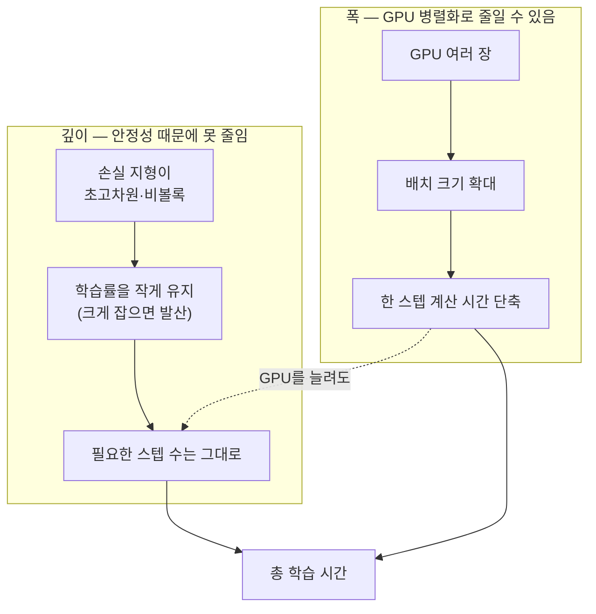
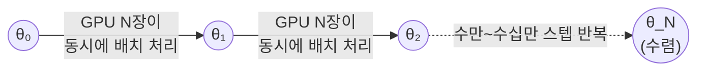
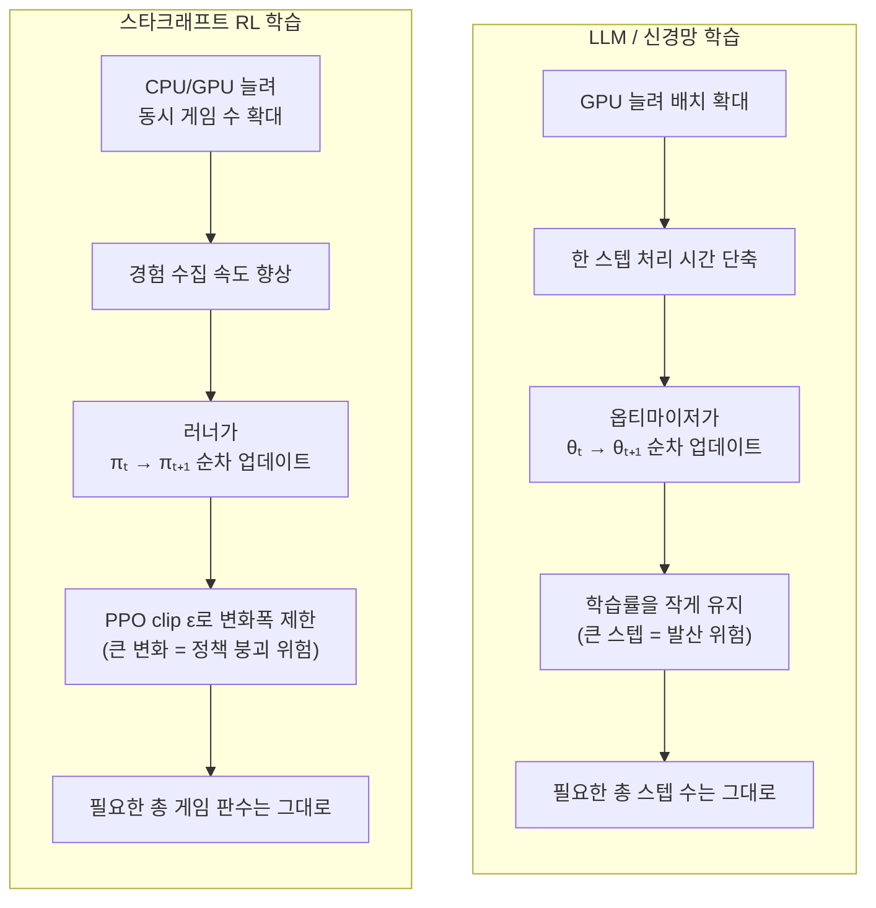

# GPU 병렬 계산을 해도 AI 학습이 오래 걸리는 이유 — 스타크래프트 RL 학습에 비유

## 쉬운 설명

학습은 "계단을 오르는 일"이에요. 계단 하나를 오르려면 반드시 그 전 계단을 먼저 밟아야 하죠 — 일꾼을 아무리 많이 데려와도 계단 순서를 건너뛸 순 없어요. GPU를 늘리는 건 "한 계단을 더 넓고 튼튼하게 만드는 것"과 비슷해서 도움이 되긴 하지만, "몇 계단을 올라야 하는지" 자체는 안 줄여줘요. 게다가 한 걸음을 너무 크게 내디디면 헛디뎌서 넘어지니까(발산), 일부러 아주 조금씩만 내디뎌야 해요. 그래서 계단 수가 원래 어마어마하게 많은 거예요.

## 일반 설명

질문의 "파라미터 조정이 너무 미세해서 그런가?"는 **절반은 정확한 직관**입니다. 다만 정확히는 "미세해서"가 아니라 **"미세하게 만들 수밖에 없어서"**이고, 그 이유는 GPU를 아무리 늘려도 사라지지 않는 두 가지 근본 제약 때문입니다.

### 1. 병렬 계산이 줄여주는 것과 못 줄여주는 것

GPU 병렬화가 잘 해주는 일: **한 스텝(step) 안에서의 계산량**을 동시에 처리하는 것. 배치(batch) 안의 데이터 여러 개를 동시에 순전파·역전파하거나, 모델을 여러 GPU에 쪼개 나눠 계산하는 것(데이터 병렬·모델 병렬).

GPU 병렬화가 못 해주는 일: **스텝 t+1의 계산은 스텝 t가 끝난 뒤의 가중치(weight)를 필요로 한다**는 시간축 순서. 경사하강법(gradient descent)은 본질적으로 "이전 가중치 → 기울기 계산 → 가중치 업데이트 → 다음 가중치"의 **순차적 사슬**입니다. GPU를 1,000개로 늘려도 이 사슬의 "몇 번째 칸"까지 왔는지는 하나씩만 진행됩니다. 즉 **병렬화는 한 걸음을 더 빨리/크게 내딛게 해주지만, 몇 걸음을 걸어야 하는지는 줄여주지 못합니다.**

### 2. 왜 한 걸음(step)을 크게 못 내딛는가 — "미세 조정"의 진짜 정체

한 번에 큰 폭으로 가중치를 바꾸면 안 되는 이유는 두 가지입니다.

- **손실함수(loss landscape)가 초고차원의 울퉁불퉁한 지형**이라서, 학습률(learning rate)을 너무 크게 잡으면 최적점을 훌쩍 지나쳐 버리거나 아예 발산(divergence)합니다. 그래서 한 스텝의 이동 폭을 작게 유지해야 하고, 결국 **목적지까지 가려면 걸음 수 자체가 많아져야** 합니다.
- **배치 크기를 키워도 이득이 어느 지점에서 뚝 끊깁니다("critical batch size").** GPU를 늘려 한 스텝에 더 많은 데이터를 몰아넣으면 기울기 추정이 더 정확해지긴 하지만, 이미 충분히 정확해진 뒤로는 배치를 2배로 키워도 필요한 스텝 수가 절반으로 안 줄어듭니다(기울기의 노이즈가 이미 낮아 추가 데이터가 새 정보를 별로 안 줌). 반면 GPU 간 동기화(gradient synchronization) 비용은 GPU 수에 비례해 계속 늘어나므로, 어느 순간부터는 **GPU를 늘려도 실제 속도 향상이 거의 없는 구간**에 들어갑니다. 실무에서 GPU 클러스터의 실제 활용률이 이론상 최대 성능의 30~50%에 그치는 것도 이 통신·동기화 오버헤드 때문입니다.

즉 "파라미터 조정이 미세하다"는 직관은 **학습률(스텝 크기)을 작게 유지해야 학습이 안정적이라는 점**에서는 맞고, 이게 곧 "왜 스텝 수 자체가 많아야 하는가"의 답입니다.

### 3. 스타크래프트 RL 학습에 비유하면 (이전 대화 연결)

지난번 다룬 [Pluto급 RTS 에이전트 학습 난이도](../reinforcement-learning/starcraft/rl-bot-training-cost-and-difficulty.md)와 [PPO 보상 설계](../reinforcement-learning/ppo-algorithm-reward-design-alphastar.md) 내용을 그대로 대응시키면 구조가 똑같습니다.

| LLM/신경망 학습 | 스타크래프트 RL 학습 |
|---|---|
| GPU를 늘려 배치 크기를 키움 = 한 스텝에 더 많은 데이터 동시 처리 | CPU/GPU를 늘려 동시에 도는 게임 수를 늘림 (TStarBot-X: 64코어 = 동시 32게임) |
| 그래도 최종 수렴까지 **필요한 옵티마이저 스텝 수**는 안 줄어듦 | 그래도 자가대국으로 강해지기까지 **필요한 게임 판수(수백만 판)**는 안 줄어듦 |
| 학습률(learning rate)을 너무 크게 잡으면 손실이 발산 | PPO의 clip range **ε(0.1~0.2)**가 "한 번의 업데이트로 정책을 30% 이상 못 바꾸게" 강제로 제한 — 너무 크게 바꾸면 그동안 배운 전략이 무너짐(비정상성 문제) |
| 스텝 t+1은 스텝 t의 가중치를 필요로 하는 순차적 사슬 | 액터(게임)는 병렬로 굴릴 수 있지만, 그 경험을 모아 **하나의 정책을 업데이트하는 러너(learner)는 결국 한 줄로 순차 진행** — actor-learner 구조의 동기화 지점 |
| 통신/동기화 오버헤드로 GPU를 늘려도 선형으로 안 빨라짐 | 신경망 추론 속도(Pluto 기준 15ms/step)가 게임 배속의 상한을 17배로 묶어버림 — 액터를 아무리 늘려도 추론이라는 물리적 하한선은 못 넘음 |

핵심은 동일합니다: **양쪽 다 "한 번에 처리하는 양(폭)"은 병렬 하드웨어로 키울 수 있지만, "안전하게 밟아야 하는 걸음 수(깊이)"는 안정적인 수렴을 위해 의도적으로 작게 유지되는 상수에 가깝고, 이게 전체 학습 시간을 지배합니다.** 스타크래프트 봇이 GPU 여러 장으로 게임을 수백 개 동시에 돌려도 "수백만 판"이라는 총량 자체는 못 줄이는 것과, LLM이 GPU 수천 장으로 배치를 키워도 "정답에 도달하기까지 필요한 업데이트 횟수·전체 데이터량(토큰 수)" 자체는 못 줄이는 것이 같은 현상입니다.

### 4. 시각화

**폭 vs 깊이**

**스텝은 순차적 사슬이다**

**LLM 학습 ↔ 스타크래프트 RL 학습 대응**

---

### 출처
- [On the Computational Inefficiency of Large Batch Sizes for Stochastic Gradient Descent (arXiv)](https://arxiv.org/pdf/1811.12941)
- [An Empirical Model of Large-Batch Training (arXiv, OpenAI)](https://arxiv.org/pdf/1812.06162)
- [Small Batch Size Training for Language Models (arXiv)](https://arxiv.org/html/2507.07101v1)
- [Hardware Scaling Trends and Diminishing Returns in Large-Scale Distributed Training (arXiv)](https://arxiv.org/html/2411.13055v1)
- [Training extremely large neural networks across thousands of GPUs](https://www.jeremyjordan.me/distributed-training/)
- 관련 문서: [Pluto급 RTS 에이전트 RL 학습 난이도](../reinforcement-learning/starcraft/rl-bot-training-cost-and-difficulty.md), [PPO 보상 설계(AlphaStar)](../reinforcement-learning/ppo-algorithm-reward-design-alphastar.md)
