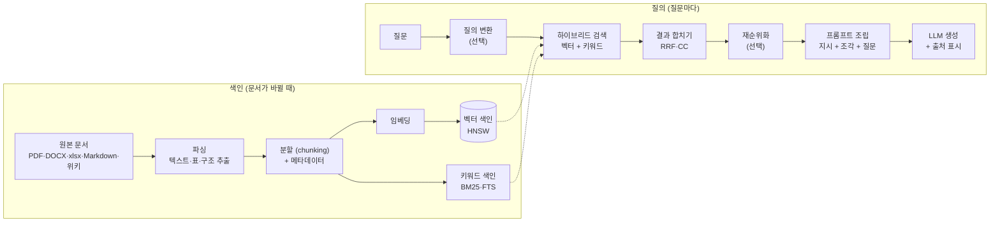
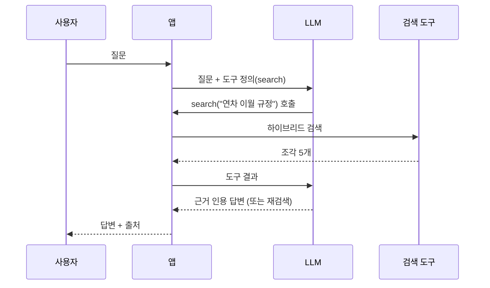

# RAG 개요와 동작 방식

## 쉬운 설명

도서관 사서에게 질문하는 것과 같다. 사서는 미리 책마다 **색인 카드**를 만들어 두고(색인), 질문이 오면 카드로 관련 쪽을 몇 장 찾아 복사한 뒤(검색), 그 복사본만 보고 답을 써 준다(생성). 답 끝에는 몇 쪽을 봤는지 적어 준다. 책이 바뀌면 카드만 다시 만들면 되고, 사서를 다시 교육할 필요는 없다.

## 일반 설명

RAG(Retrieval-Augmented Generation, 검색 증강 생성)는 LLM이 답하기 전에 **외부 문서에서 관련 조각을 찾아 프롬프트에 붙이는** 구성이다. 모델은 바꾸지 않고, 모델이 볼 입력을 바꾼다.

### 1. 무엇을 해결하나

| 문제 | LLM 단독 | RAG |
|---|---|---|
| 학습 이후·사내 지식 | 모른다 (지식 컷오프) | 문서를 색인하면 바로 반영 |
| 근거 제시 | 출처를 댈 수 없다 | 검색한 조각을 인용 |
| 환각 | 모르는 것도 지어낸다 | 근거가 있을 때만 답하도록 지시할 수 있다 (줄어들 뿐 사라지지 않는다) |
| 지식 갱신 비용 | 재학습·미세 조정 | 문서 재색인 |
| 권한별 답변 | 불가 | 검색 단계에서 사용자 권한으로 거르기 |

### 2. 전체 구조: 색인 파이프라인과 질의 파이프라인

RAG는 **미리 하는 일(오프라인 색인)**과 **질문마다 하는 일(온라인 질의)** 두 갈래로 나뉜다.



### 3. 색인 파이프라인

1. **파싱**: 원본에서 텍스트와 구조(제목 계층, 표, 쪽 번호)를 뽑는다. 품질의 첫 관문이다. 표가 깨지거나 머리글·바닥글이 본문에 섞이면 뒤 단계에서 되돌릴 수 없다. 형식별 파서 선택 → [사내 RAG 데이터 유형과 파서](../../../inquiry/ai/0043-internal-rag-data-types-and-parsers-spring-ai.md), [PDF를 Markdown으로](../../../inquiry/ai/0045-pdf-to-markdown-java-options.md).
2. **분할(chunking)**: 문서를 검색 단위로 자른다.
   - 고정 길이(예: 500~1,000 토큰, 10~20% 겹침): 단순하지만 문단·표 중간을 자른다.
   - **구조 기반**: 제목(heading) 경로·조항·표 행 단위. 사내 규정·위키처럼 구조가 있는 문서에 맞다.
   - 조각마다 **메타데이터**를 붙인다: 문서 ID, 제목 경로(breadcrumb), 버전, 권한(ACL), 원본 위치. 검색 필터와 출처 표시에 쓰인다.
   - 조각이 문맥을 잃는 문제("그 회사의 매출은…"에서 "그 회사"가 누구인지 모름)는 제목 경로를 앞에 붙이거나, LLM이 쓴 문맥 설명을 붙이는 방식(Contextual Retrieval)으로 줄인다.
3. **임베딩**: 조각을 고정 길이 벡터(예: 1024차원)로 바꾼다. 뜻이 가까운 문장은 벡터 공간에서 가깝다 → [AI에서 벡터의 의미](../../../inquiry/ai/0011-vector-meaning-general-math-vs-ai-embedding.md). **질문과 문서는 반드시 같은 모델로** 임베딩한다.
4. **저장**:
   - 벡터 색인: 근사 최근접 이웃(ANN) 탐색용. HNSW(그래프)가 기본값이고 IVF(군집)도 쓰인다. 거리는 보통 코사인.
   - 키워드 색인: BM25나 DB 전문 검색(FTS). 한국어는 형태소 분석(Nori, Kiwi, mecab-ko)이나 2-gram(pg_bigm)이 필요하다 → [한국어 RAG 임베딩·토큰화](../../../inquiry/ai/0039-korean-rag-embedding-model-selection-vs-bpe.md), [pg_bigm](../../../inquiry/database/0014-pg-bigm-vs-like-search.md).
   - 저장소 선택(pgvector vs 전용 벡터 DB) → [pgvector vs 전용 Vector DB](../../../inquiry/database/0015-pgvector-vs-dedicated-vector-db.md).

### 4. 질의 파이프라인

1. **질의 변환(선택)**: 대화 맥락을 넣어 질문을 다시 쓰거나(질의 재작성), 여러 하위 질문으로 나누거나, 가상의 답을 만들어 그것으로 검색한다(HyDE).
2. **하이브리드 검색**: 벡터 검색과 키워드 검색을 함께 돌린다.

   | | 벡터(밀집) 검색 | 키워드(희소) 검색 |
   |---|---|---|
   | 잘 찾는 것 | 다른 말로 쓴 같은 뜻("휴가" ↔ "연차") | 고유명사, 코드, 조항 번호, 숫자, 약어 |
   | 약한 것 | 정확한 식별자, 드문 용어 | 동의어, 바꿔 말하기 |
   | 점수 | 코사인 유사도 (0~1 근처) | BM25 점수 (상한 없음) |

3. **결과 합치기(fusion)**: 두 점수는 척도가 달라 그대로 더할 수 없다.
   - **RRF(Reciprocal Rank Fusion)**: 점수는 버리고 순위만 쓴다. `score(d) = Σ 1 / (k + rank_i(d))`, 보통 `k = 60`. 튜닝이 거의 필요 없어 기본값으로 많이 쓴다.
   - **CC(Convex Combination)**: 각 점수를 0~1로 정규화한 뒤 `α·벡터 + (1−α)·키워드`로 더한다. 점수 크기 차이(1등과 2등이 얼마나 차이 나는지)를 살릴 수 있지만, 정규화 방식과 `α`를 평가 데이터로 맞춰야 한다.
4. **재순위화(선택)**: 상위 수십 개(예: 50개)를 **크로스 인코더**가 질문과 조각을 함께 읽고 다시 점수를 매겨 상위 몇 개(예: 5개)만 남긴다. 이중 인코더(임베딩)보다 정확하지만 후보마다 모델을 돌려야 해서 느리다.
5. **프롬프트 조립과 생성**: 시스템 지시("아래 근거로만 답하고, 근거가 없으면 모른다고 답하라. 출처를 [번호]로 표시하라") + 조각(번호·제목 경로 포함) + 질문을 LLM에 보낸다.

### 5. 두 가지 호출 방식: 항상 검색 vs 도구로 검색

| | 2단계(파이프라인) RAG | 에이전틱 RAG |
|---|---|---|
| 검색 시점 | 질문마다 **항상** 먼저 검색 | LLM이 **필요하다고 판단할 때** 검색 도구를 호출 (function calling) |
| 검색 횟수 | 1회 | 0~N회 (결과를 보고 질의를 바꿔 재검색) |
| 장점 | 지연·비용이 예측 가능, 단순 | 잡담은 검색을 건너뛰고, 다단계 질문을 풀 수 있다 |
| 단점 | 검색이 필요 없는 질문에도 비용 | 지연·비용 변동, 루프 상한·검색 누락 위험 |



### 6. 바로 써 보기

PostgreSQL + pgvector로 하이브리드 검색(RRF)을 SQL 하나로 쓰는 예:

```sql
-- 조각 테이블: 벡터와 전문 검색 색인을 함께 둔다
CREATE TABLE chunk (
    id         bigserial PRIMARY KEY,
    doc_id     bigint NOT NULL,
    heading    text,                      -- 제목 경로 (출처 표시·문맥 보강)
    content    text NOT NULL,
    embedding  vector(1024) NOT NULL,     -- 임베딩 모델 차원과 같아야 한다
    tsv        tsvector                   -- 키워드 색인 (한국어는 형태소 분석 결과로 채운다)
);
CREATE INDEX ON chunk USING hnsw (embedding vector_cosine_ops);
CREATE INDEX ON chunk USING gin (tsv);

-- 하이브리드 검색: 각각 상위 50개를 순위로 합친다 (RRF, k = 60)
WITH v AS (
    SELECT id, row_number() OVER (ORDER BY embedding <=> $1) AS r
    FROM chunk ORDER BY embedding <=> $1 LIMIT 50
), k AS (
    SELECT id, row_number() OVER (ORDER BY ts_rank(tsv, q) DESC) AS r
    FROM chunk, to_tsquery('simple', $2) q
    WHERE tsv @@ q ORDER BY ts_rank(tsv, q) DESC LIMIT 50
)
SELECT id, sum(1.0 / (60 + r)) AS score
FROM (SELECT * FROM v UNION ALL SELECT * FROM k) t
GROUP BY id ORDER BY score DESC LIMIT 10;
```

Spring AI(2.x)는 `RetrievalAugmentationAdvisor`로 질의 변환 → 검색 → 문서 후처리 → 프롬프트 보강을 조립한다:

```java
// 검색 결과가 없으면 모른다고 답하도록 빈 문맥을 허용하지 않는다
Advisor rag = RetrievalAugmentationAdvisor.builder()
        .queryTransformers(RewriteQueryTransformer.builder()
                .chatClientBuilder(chatClientBuilder.build().mutate())
                .build())
        .documentRetriever(VectorStoreDocumentRetriever.builder()
                .vectorStore(vectorStore)
                .similarityThreshold(0.5)
                .topK(5)
                .build())
        .queryAugmenter(ContextualQueryAugmenter.builder()
                .allowEmptyContext(false)
                .build())
        .build();

String answer = chatClient.prompt()
        .advisors(rag)
        .user("연차는 다음 해로 이월되나요?")
        .call()
        .content();
```

`PgVectorStore`는 벡터 검색만 하므로, 하이브리드 검색이 필요하면 위 SQL처럼 직접 `DocumentRetriever`를 구현한다 → [사내 규정 RAG 설계 — PgVectorStore를 쓸까](../../../inquiry/ai/0040-rag-internal-policy-xlsx-ingestion-design.md#6-spring-ai-pgvectorstore를-쓸까).

## 관련 문서

- [RAG의 역사](./01-history.md)
- [RAG 트레이드오프와 선택 기준](./03-tradeoffs.md)
- [RAG 운영 시 흔한 함정과 해결 방법](./04-pitfalls.md)
- [RAG 장애 유형과 대응](./05-failure-modes.md)
- [RAG 실습: 백엔드 구조](./06-labs.md)
- [RAG·벡터 DB 도입 시 아키텍처 변화](../../../inquiry/ai/0015-rag-vector-db-architecture-change.md)
- [사내 규정 RAG 시범 구축 설계](../../../inquiry/ai/0040-rag-internal-policy-xlsx-ingestion-design.md)
- [한국어 임베딩: KURE vs API 모델](../../../inquiry/ai/0044-korean-embedding-kure-vs-api-models.md)

## 참고 자료

- [Lewis et al., Retrieval-Augmented Generation for Knowledge-Intensive NLP Tasks (2020) — arXiv](https://arxiv.org/abs/2005.11401)
- [Introducing Contextual Retrieval — Anthropic](https://www.anthropic.com/research/contextual-retrieval)
- [Retrieval Augmented Generation — Spring AI Reference](https://docs.spring.io/spring-ai/reference/api/retrieval-augmented-generation.html)
- [pgvector — GitHub](https://github.com/pgvector/pgvector)
- [12 Advanced RAG Techniques — Atlan](https://atlan.com/know/advanced-rag-techniques/)
