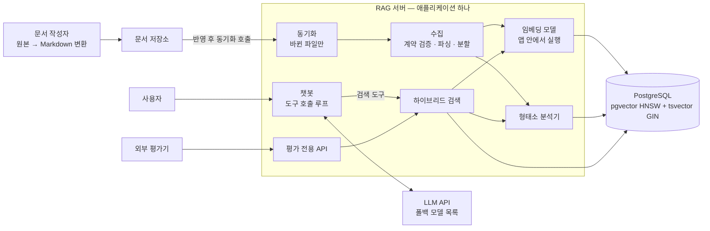
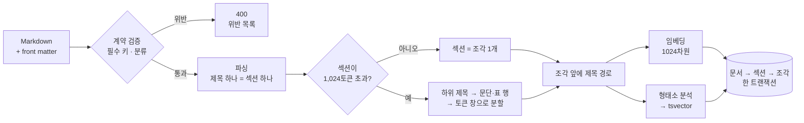
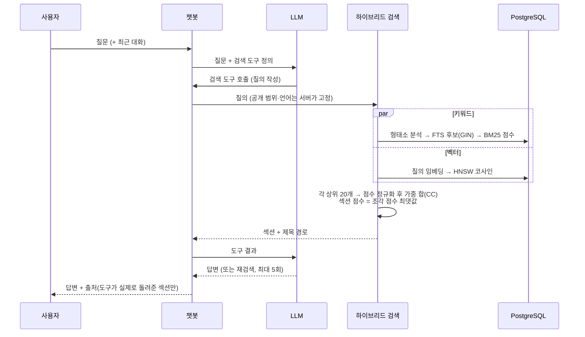

# RAG 실습: 백엔드 구성 기록

RAG의 컴포넌트 구성(수집 → 색인 → 하이브리드 검색 → 생성)은 어느 정도 규격화돼 있다. 이 문서는 직접 만든 RAG 백엔드의 구성 기록이다. 개념은 [RAG 개요](./02-overview.md)에 있다.

## 1. 전체 구성

- 임베딩 모델(ONNX)과 형태소 분석기는 **서버 프로세스 안**에서 돈다. 문서가 외부 임베딩 API로 나가지 않는다.
- 저장소는 PostgreSQL 하나다. 조각 한 행에 벡터(HNSW 색인)와 형태소 분석 결과(tsvector, GIN 색인)를 함께 둔다.
- 평가 API는 운영과 분리된 공간(namespace)에서만 동작하고, 운영 환경에서는 켜지지 않는다.

## 2. 색인 흐름

- 문서 → 섹션 → 조각의 3단 구조다. **조각으로 찾고 섹션 전체를 돌려준다**(parent-child).
- 같은 내용(해시 동일)은 다시 넣지 않고, 임베딩이 실패하면 문서 전체를 되돌린다.
- 조각마다 임베딩 모델 이름·리비전·차원과 공개 범위·언어를 저장한다.

## 3. 질의 흐름

- 근거가 없으면 "등록된 문서에서 찾지 못했다"고 답하도록 시스템 지시에 둔다.
- 출처는 모델이 쓴 글이 아니라 **도구가 실제로 반환한 섹션**에서 모은다.
- 질의 임베딩이 실패하면 키워드 결과만으로 답하고 강등 표시를 남긴다. LLM은 404·429·5xx에서 다음 모델로 넘어간다.

## 4. 평가 기준

- 공개 한국어 검색 벤치마크(AutoRAG Retrieval)를 Markdown으로 옮긴 세트(문서 32개·질문 114개)로 **섹션 단위 MRR@10**을 쟀다.
- 기준: MRR@10이 **+0.02 이상** 오르고 Hit@5가 떨어지지 않으면 채택. 차이가 질문 한두 개 수준이면 더 단순한 쪽을 남긴다.
- 숫자만 보고 정하지 않고, 결과와 나빠진 질문은 **사람이 직접 확인**한 뒤 정했다.

## 5. 컴포넌트별 비교

| 컴포넌트 | 비교한 것 | 고른 것 | 이유 |
|---|---|---|---|
| 분할 크기 | 512 / 1024 / 2048 토큰 | 1024 | 512는 잘리는 내용이 많고, 2048은 나을 근거가 없었다 |
| 분할 방식 | 고정 길이 / 제목 단위 섹션 | 제목 단위 섹션 | 의미 단위가 안 깨지고 출처를 제목으로 보여 줄 수 있다. 넘치는 섹션만 다시 나눈다 |
| 키워드 색인 | FTS + GIN / pg_bigm 등 DB 확장 | FTS + GIN | DB 확장 없이 쓸 수 있다. FTS는 후보만 뽑고 점수는 따로 매긴다 |
| 키워드 점수 | ts_rank / BM25 | BM25 | 지금은 비슷하지만 문서가 많아지면 IDF가 있는 BM25가 나을 것 |
| 형태소 분석기 | Nori / Kiwi | Kiwi | 키워드 검색 MRR이 올랐다 |
| 임베딩 모델 | KURE-v1 / KURE-v3 (bge-m3 등은 벤치마크로만) | KURE-v3 | 벡터 검색 MRR이 크게 올랐고, Kiwi와 함께 바꿨을 때 전체가 기준을 넘었다. 대신 느리고 메모리가 크다 |
| 검색 구성 | 벡터만 / 키워드만 / 하이브리드 | 하이브리드 | 서로 놓치는 것을 메운다. 임베딩이 죽어도 키워드로 답할 수 있다 |
| 결과 합치기 | RRF / CC | CC (임시) | 차이는 작았다. 실제 질문이 쌓이면 다시 잰다 |
| 재순위화 | 있음 / 없음 | 없음 | 이득이 작고 느리다 |
| 벡터 필터 | 일반 HNSW + 필터 / 필터별 부분 HNSW | 부분 HNSW | 필터를 걸면 결과가 모자라던 문제가 없어졌다 |

## 6. 다음에 다시 볼 것

- 실제 사용자 질문이 쌓이면: 합치기 방식과 가중치, 분할 크기를 다시 잰다.
- 문서가 크게 늘면: BM25 효과와 벡터 색인 정확도를 다시 본다.
- GPU가 생기면: 재순위화를 다시 본다.
- 더 나은 한국어 임베딩 모델이 나오면: 같은 세트로 비교한다.

## 관련 문서

- [RAG의 역사](./01-history.md)
- [RAG 개요와 동작 방식](./02-overview.md)
- [RAG 트레이드오프와 선택 기준](./03-tradeoffs.md)
- [RAG 운영 시 흔한 함정과 해결 방법](./04-pitfalls.md)
- [RAG 장애 유형과 대응](./05-failure-modes.md)
- [한국어 RAG 임베딩 선택](../../../inquiry/ai/0039-korean-rag-embedding-model-selection-vs-bpe.md)
- [LLM 없이 검색만 자동 평가](../../../inquiry/ai/0048-retrieval-only-eval-automation-allganize-dataset.md)

## 참고 자료

- [nlpai-lab/KURE — GitHub](https://github.com/nlpai-lab/KURE)
- [Kiwi 한국어 형태소 분석기 — GitHub](https://github.com/bab2min/Kiwi)
- [pgvector — GitHub](https://github.com/pgvector/pgvector)
