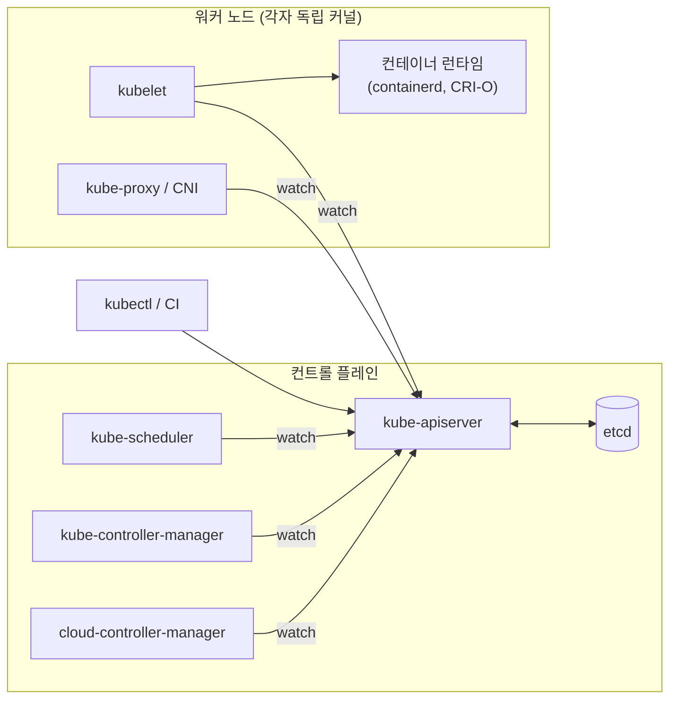

# Kubernetes 개요 — 구조와 동작 방식

## 쉬운 설명

Kubernetes에게는 "이 프로그램을 항상 3개 띄워 둬"라고 **원하는 모습만 적어 낸다**. 그러면 관리자 프로그램 여럿이 지금 모습을 계속 들여다보다가, 적어 낸 모습과 다르면(하나가 죽었으면) 차이만큼 고친다. 사람은 "어떻게"가 아니라 "무엇을"만 말한다.

## 일반 설명

### 1. 무엇을 해결하나

| 문제 | Kubernetes의 답 |
|---|---|
| 컨테이너를 어느 머신에 놓나 | **스케줄러**가 자원 요청량·제약 조건으로 노드 선택 |
| 죽으면 누가 다시 띄우나 | **컨트롤러**가 원하는 상태(replicas: 3)와 실제 상태를 계속 비교해 맞춤 |
| 위치가 바뀌는 컨테이너를 어떻게 찾나 | **Service**(고정 가상 IP) + 클러스터 DNS |
| 배포 중 무중단 교체 | **Deployment**의 롤링 업데이트, 롤백 |
| 설정·비밀값 분리 | ConfigMap, Secret |
| 부하에 따라 늘리기 | HPA(파드 수), VPA(파드 크기), 노드 오토스케일러 |

핵심 아이디어는 **선언형 API + 조정 루프(reconciliation loop)** 다. 모든 기능이 "API 서버에 저장된 원하는 상태를 watch하는 컨트롤러" 형태로 만들어져 있어, 사용자가 같은 방식으로 기능을 추가할 수 있다(CRD + 오퍼레이터).

### 2. 구조: 컨트롤 플레인과 노드



| 구성요소 | 위치 | 역할 |
|---|---|---|
| **kube-apiserver** | 컨트롤 플레인 | 유일한 입구. 인증·인가·어드미션 후 etcd에 저장. 나머지 모든 구성요소는 API 서버만 바라본다 |
| **etcd** | 컨트롤 플레인 | 클러스터 상태 전체를 담는 Raft 기반 KV 저장소. 유일한 상태 저장소 |
| **kube-scheduler** | 컨트롤 플레인 | 노드가 정해지지 않은 Pod에 노드를 배정(필터링 → 점수 매기기) |
| **kube-controller-manager** | 컨트롤 플레인 | Deployment, ReplicaSet, Node, Job 등 내장 컨트롤러 묶음 |
| **cloud-controller-manager** | 컨트롤 플레인 | 클라우드 LB·노드·라우트 연동 (`type: LoadBalancer` 등) |
| **kubelet** | 각 노드 | 자기 노드에 배정된 Pod를 CRI로 실행, 상태·헬스체크 보고, Lease로 하트비트 |
| **컨테이너 런타임** | 각 노드 | containerd, CRI-O. 1.24부터 Docker Engine 직접 지원(dockershim) 없음 |
| **kube-proxy / CNI** | 각 노드 | Service 가상 IP → Pod IP 변환(iptables·nftables, 또는 Cilium 같은 eBPF 대체), Pod 네트워크 |

- 노드마다 **커널이 따로** 있다. 클러스터가 하나의 컴퓨터처럼 보이는 것은 API 서버가 만든 착시다 → [클러스터 커널 모델](../../../inquiry/infra/0016-kubernetes-cluster-kernel-model.md), [Pod와 호스트 커널 공유](../../../inquiry/infra/0010-pod-host-kernel-sharing.md).
- 구성요소끼리 직접 호출하지 않고 **API 서버를 watch**한다. watch 연결의 생명주기·신선도는 [Watch 정리](../../../inquiry/infra/0017-kubernetes-node-kernel-watch-summary.md)에 있다.
- 그림 위주 전체 구조는 [아키텍처 다이어그램](../../../inquiry/infra/0001-kubernetes-architecture-diagram.md).

### 3. `kubectl apply`에서 컨테이너가 뜨기까지

1. `kubectl apply -f deploy.yaml` → API 서버가 인증·인가·어드미션(검증·변형) 후 Deployment를 etcd에 저장
2. Deployment 컨트롤러가 watch로 감지 → ReplicaSet 생성 → ReplicaSet 컨트롤러가 Pod 3개 생성(`nodeName` 비어 있음)
3. 스케줄러가 노드 배정 → Pod의 `nodeName` 갱신
4. 해당 노드 kubelet이 감지 → CRI로 이미지 풀·컨테이너 생성, CNI로 IP 할당
5. readinessProbe 통과 → EndpointSlice에 등록 → Service로 트래픽 유입

어느 단계든 실패하면 컨트롤러가 다음 루프에서 다시 시도한다. 그래서 "명령이 실패했다"가 아니라 "원하는 상태에 아직 도달하지 못했다"로 나타난다(`Pending`, `CrashLoopBackOff`).

### 4. 주요 리소스

| 분류 | 리소스 | 용도 |
|---|---|---|
| 실행 단위 | **Pod** | 컨테이너 1개 이상 + 공유 네트워크·볼륨. 가장 작은 배포 단위. 일회용 |
| 워크로드 | **Deployment** (→ ReplicaSet) | 무상태 앱. 롤링 업데이트·롤백 |
| | **StatefulSet** | 고정 이름(`db-0`)·고정 볼륨이 필요한 DB·브로커 |
| | **DaemonSet** | 노드마다 1개 (로그 수집기, CNI 에이전트) |
| | **Job / CronJob** | 끝나는 작업, 주기 작업 |
| 네트워크 | **Service** (ClusterIP / NodePort / LoadBalancer) | Pod 묶음에 고정 IP·DNS 이름 |
| | **Ingress** / **Gateway API** | L7(HTTP) 진입점. Ingress API는 동결, 신규 기능은 Gateway API |
| | NetworkPolicy | Pod 간 방화벽 (CNI가 지원해야 동작) |
| 설정 | ConfigMap, Secret | 설정·비밀값 주입 (Secret은 기본 base64일 뿐 암호화가 아님) |
| 저장소 | PV, PVC, StorageClass | 볼륨 요청과 동적 프로비저닝 (CSI 드라이버) |
| 격리·권한 | Namespace, RBAC(Role, RoleBinding), ServiceAccount, ResourceQuota | 팀·환경 구분과 권한 |
| 확장 | CRD + 오퍼레이터 | 사용자 정의 리소스와 그 컨트롤러 (예: DB 오퍼레이터) |

### 5. 자원과 스케줄링

- **requests**: 스케줄러가 노드 자리를 잡는 기준(예약량). **limits**: 런타임이 강제하는 상한. CPU 초과는 스로틀링, 메모리 초과는 OOMKill.
- requests·limits 설정에 따라 **QoS 클래스**가 정해진다: Guaranteed(모든 컨테이너 requests = limits) > Burstable > BestEffort(아무것도 없음). 노드 메모리가 부족하면 BestEffort부터 축출된다.
- 배치 제약: nodeSelector·affinity(어디에 놓을지), taint·toleration(어디에 못 놓게), topologySpreadConstraints(존·노드에 고르게).
- **In-place resize**(1.35 GA): Pod를 다시 만들지 않고 CPU·메모리 requests/limits를 바꾼다.
- **DRA**(1.34 GA): GPU 같은 장치를 `nvidia.com/gpu: 1` 같은 개수가 아니라 ResourceClaim으로 속성(모델, 메모리)을 지정해 요청한다.
- 노드는 cgroup v2가 기준이다. 1.35부터 cgroup v1 노드에서는 kubelet이 기본적으로 시작하지 않는다.

### 6. 네트워킹 모델

| 규칙 | 의미 |
|---|---|
| 모든 Pod는 고유 IP를 가진다 | 포트 충돌·NAT 없이 Pod끼리 직접 통신 |
| 모든 Pod는 노드와 무관하게 서로 통신할 수 있다 | 구현은 CNI 플러그인(Calico, Cilium, AWS VPC CNI 등) 몫 |
| Service는 가상 IP로 Pod 묶음을 대표한다 | kube-proxy(iptables, nftables) 또는 eBPF가 연결마다 Pod 선택 |

트래픽 경로별 세부 문서:

- 외부 → 클러스터(L7): [Ingress 트래픽 분산](../../../inquiry/infra/0020-kubernetes-ingress-load-balancing.md)
- Service LoadBalancer·kube-proxy·GSLB: [Service LB와 GSLB](../../../inquiry/infra/0021-kubernetes-service-loadbalancer-gslb.md)
- Pod → 외부(egress): [Pod egress 설정](../../../inquiry/infra/0022-pod-outbound-egress-traffic-configuration.md)
- 서비스 간 mTLS·재시도: [Istio 서비스 메시](../../../inquiry/infra/0026-istio-service-mesh-overview.md)

### 7. 오토스케일링 3층

| 층 | 도구 | 바꾸는 것 |
|---|---|---|
| Pod 수 | HPA (1.37에서 scale-to-zero 베타·기본 활성), KEDA | replicas |
| Pod 크기 | VPA (in-place resize와 결합 가능) | requests·limits |
| 노드 수 | Cluster Autoscaler, Karpenter | 클라우드 VM 수 |

코어는 노드를 직접 늘리지 않는다. 이유와 도구 비교는 [워커 노드 오토스케일링](../../../inquiry/infra/0018-kubernetes-worker-node-autoscaling.md).

### 8. 기본 사용법

```yaml
apiVersion: apps/v1
kind: Deployment
metadata:
  name: web
spec:
  replicas: 3
  selector:
    matchLabels: { app: web }
  template:
    metadata:
      labels: { app: web }
    spec:
      containers:
        - name: web
          image: nginx:1.29
          ports: [{ containerPort: 80 }]
          resources:
            requests: { cpu: 100m, memory: 128Mi }
            limits: { memory: 256Mi }
          readinessProbe:
            httpGet: { path: /, port: 80 }
---
apiVersion: v1
kind: Service
metadata:
  name: web
spec:
  selector: { app: web }
  ports: [{ port: 80, targetPort: 80 }]
```

```bash
kubectl apply -f web.yaml               # 원하는 상태 제출
kubectl get pods -l app=web -o wide     # 어느 노드에 떴나
kubectl rollout status deploy/web       # 롤링 업데이트 진행
kubectl rollout undo deploy/web         # 직전 버전으로 롤백
kubectl describe pod <pod>              # Events: 스케줄 실패·이미지 풀 실패 원인
kubectl logs <pod> --previous           # 재시작 전 컨테이너 로그
```

관리형(EKS 등)을 쓰면 이 중 무엇이 자동화되고 무엇이 그대로 사용자 몫인지는 [EKS가 자동화하는 것](../../../inquiry/infra/0024-eks-what-is-automated-vs-kubectl-yaml.md)에 있다.

## 관련 문서

- [Kubernetes의 역사](./01-history.md)
- [Kubernetes 트레이드오프와 선택 기준](./03-tradeoffs.md)
- [Kubernetes 운영 시 흔한 함정과 해결 방법](./04-pitfalls.md)
- [Kubernetes 장애 유형과 복구](./05-failure-modes.md)
- ["k8s는 시스템의 추상화다" — 맞는 답인가?](../../../inquiry/infra/0025-kubernetes-as-system-abstraction.md)
- [systemd 싱글 인스턴스 vs 쿠버네티스 Pod](../../../inquiry/infra/0015-systemd-single-instance-vs-kubernetes-pod.md)

## 참고 자료

- [Cluster Architecture — Kubernetes Docs](https://kubernetes.io/docs/concepts/architecture/)
- [Kubernetes Components — Kubernetes Docs](https://kubernetes.io/docs/concepts/overview/components/)
- [Pod Quality of Service Classes — Kubernetes Docs](https://kubernetes.io/docs/concepts/workloads/pods/pod-qos/)
- [Services, Load Balancing, and Networking — Kubernetes Docs](https://kubernetes.io/docs/concepts/services-networking/)
- [Ingress — Kubernetes Docs](https://kubernetes.io/docs/concepts/services-networking/ingress/)
- [Sidecar Containers — Kubernetes Docs](https://kubernetes.io/docs/concepts/workloads/pods/sidecar-containers/)
- [Kubernetes 1.35: In-Place Pod Resize Graduates to Stable — Kubernetes Blog](https://kubernetes.io/blog/2025/12/19/kubernetes-v1-35-in-place-pod-resize-ga/)
- [Kubernetes v1.34: DRA has graduated to GA — Kubernetes Blog](https://kubernetes.io/blog/2025/09/01/kubernetes-v1-34-dra-updates/)
- [The Shift to cgroup v2 in Kubernetes — Kubernetes Blog](https://kubernetes.io/blog/2026/10/06/kubernetes-cgroups-v2-shift/)
- [Kubernetes v1.37: Garhwal — Kubernetes Blog](https://kubernetes.io/blog/2026/08/26/kubernetes-v1-37-release/)
