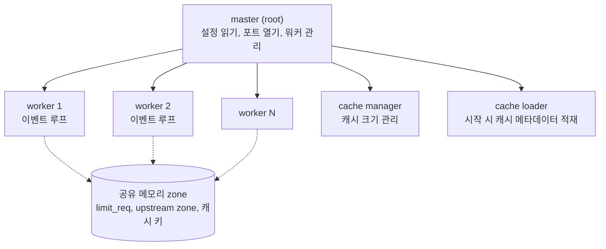

# NGINX 개요와 기본 사용법

## 쉬운 설명

NGINX는 건물 1층의 **안내 데스크**다. 손님(요청)이 오면 주소(도메인)와 찾는 곳(URL 경로)을 보고, 1층 진열대에 있는 물건(정적 파일)은 바로 내주고, 위층 사무실(백엔드 서버)에 가야 하는 일은 대신 전달해 결과를 받아 돌려준다. 사무실이 여러 개면 덜 바쁜 곳으로 나눠 보낸다. 데스크 직원은 몇 명뿐이지만 기다리는 동안 다른 손님을 받기 때문에 수만 명을 동시에 응대한다.

## 일반 설명

### 1. 무엇을 해결하나

| 역할 | 하는 일 | 대표 지시어·모듈 |
|---|---|---|
| 정적 파일 서버 | 디스크 파일을 커널 `sendfile`로 바로 전송 | `root`, `alias`, `try_files`, `sendfile` |
| **리버스 프록시** | 클라이언트 요청을 백엔드(HTTP·FastCGI·uwsgi·gRPC)로 전달 | `proxy_pass`, `fastcgi_pass`, `grpc_pass` |
| **로드 밸런서** | 여러 백엔드에 분산, 실패한 서버 제외 | `upstream`, `server`, `least_conn`, `hash` |
| TLS 종료 | HTTPS·HTTP/2·HTTP/3을 받아 백엔드에는 평문 또는 재암호화로 전달 | `ssl_certificate`, `http2`, `listen ... quic` |
| 캐시 | 백엔드 응답을 디스크에 저장해 재사용 | `proxy_cache_path`, `proxy_cache` |
| 트래픽 제어 | 요청률·동시 연결 제한, 접근 제어 | `limit_req`, `limit_conn`, `allow/deny`, `auth_request` |
| L4 프록시 | TCP·UDP를 그대로 전달(DB, DNS, MQTT 등) | `stream {}`, `ssl_preread` |
| 메일 프록시 | IMAP·POP3·SMTP 프록시 | `mail {}` |

한 프로세스로 위 역할을 겸하는 것이 NGINX의 쓰임새다. 보통 "앱 서버 앞단 1개"로 시작해 TLS·정적 파일·라우팅·분산을 몰아 맡긴다.

### 2. 프로세스 구조 — 마스터와 워커



| 구성 요소 | 내용 |
|---|---|
| master | 설정 파싱, 소켓 바인딩, 워커 생성(`fork`)·재시작, 시그널 처리. 요청은 처리하지 않음 |
| worker | 단일 스레드 + 이벤트 루프 1개. 연결을 논블로킹으로 처리. 보통 `worker_processes auto`(코어 수) |
| 연결 수 | 워커당 `worker_connections`(기본 512). 프록시는 연결 1개당 클라이언트·백엔드 2개를 쓴다 |
| 메모리 | 공식 수치로 유휴 keep-alive 연결 1만 개에 약 2.5MB |
| 공유 상태 | 워커끼리 직접 통신하지 않고 공유 메모리 zone으로만 상태를 나눔 |
| 블로킹 작업 | 디스크 읽기 등은 스레드 풀(`aio threads`)로 넘겨 이벤트 루프가 멈추지 않게 함 |

워커 하나가 블로킹되면 그 워커가 맡은 수천 연결이 함께 멈춘다. 이벤트 루프의 상세는 [nginx 워커의 이벤트 루프](../../../inquiry/web/0007-nginx-worker-event-loop-architecture.md)에, 이 구조를 택한 대가는 [트레이드오프](./03-tradeoffs.md#1-핵심-설계-선택-얻은-것과-포기한-것)에 있다.

### 3. 설정 구조 — 컨텍스트와 상속

```nginx
user nginx;
worker_processes auto;                 # main 컨텍스트

events { worker_connections 4096; }

http {                                 # HTTP 전체
    include       mime.types;
    sendfile      on;

    upstream app {                     # 백엔드 그룹
        least_conn;
        server 10.0.0.11:8080 max_fails=3 fail_timeout=10s;
        server 10.0.0.12:8080 max_fails=3 fail_timeout=10s;
    }

    server {                           # 가상 호스트
        listen 443 ssl;
        http2 on;
        server_name api.example.com;
        ssl_certificate     /etc/nginx/tls/fullchain.pem;
        ssl_certificate_key /etc/nginx/tls/privkey.pem;

        location /static/ { root /srv; expires 7d; }
        location / {
            proxy_pass http://app;
            proxy_set_header Host $host;
            proxy_set_header X-Forwarded-For $proxy_add_x_forwarded_for;
        }
    }
}

stream {                               # L4 프록시
    server { listen 5432; proxy_pass 10.0.0.21:5432; }
}
```

- 바깥 컨텍스트의 지시어는 안쪽으로 **상속**된다. 단 `add_header`, `proxy_set_header` 같은 배열형 지시어는 안쪽에 하나라도 쓰면 바깥 것이 **모두 사라진다**(1.29.3부터 `add_header_inherit`로 조절 가능). 이 함정은 [흔한 함정 — 설정](./04-pitfalls.md#1-설정-함정)에 있다.
- 설정은 선언형이다. `if`는 rewrite 모듈의 지시어일 뿐 프로그래밍 언어의 분기가 아니다.

### 4. 요청이 어디로 가나 — server와 location 선택

| 단계 | 규칙 |
|---|---|
| 1. `listen` | 요청이 들어온 IP:포트에 맞는 server 블록 후보를 고른다 |
| 2. `server_name` | `Host` 헤더(TLS는 SNI)로 고른다. 순서: 정확히 일치 → `*.example.com` 앞 와일드카드 → 뒤 와일드카드 → 정규식(설정 순서) |
| 3. 기본 서버 | 아무것도 안 맞으면 그 포트의 `default_server`, 없으면 **처음 정의된 server** |
| 4. `location` | `=` 정확 일치가 있으면 끝 → 가장 긴 접두사 기억(`^~`이면 끝) → 정규식(`~`, `~*`)을 **설정 순서대로** 검사해 첫 일치 → 없으면 기억한 접두사 |

location이 정해지면 요청은 11개 처리 단계(rewrite → access → content → log 등)를 지난다. 단계 목록과 Lua·njs가 끼어드는 지점은 [nginx 요청 처리 단계](../../../inquiry/web/0004-nginx-openresty-njs-request-processing-phases.md), [init·rewrite·content 단계 구분](../../../inquiry/web/0003-nginx-lua-init-rewrite-content-phase-distinction.md)에 있다.

### 5. 로드 밸런싱

| 방식 | 지시어 | 특징 |
|---|---|---|
| 가중 라운드 로빈 | (기본) | `weight`로 비율 |
| 최소 연결 | `least_conn` | 요청 처리 시간이 들쭉날쭉할 때 |
| 클라이언트 IP 해시 | `ip_hash` | IPv4는 앞 3옥텟 기준. NAT 뒤 사용자가 한 서버로 몰릴 수 있음 |
| 일반 해시 | `hash $key consistent` | 캐시 서버처럼 키 고정 배치. `consistent`는 케타마 일관 해시 |
| 무작위 2개 중 선택 | `random two least_conn` | 여러 LB가 같은 백엔드를 볼 때 쏠림 완화 |
| 세션 어피니티 | `sticky cookie/route/learn` | 1.29.6부터 오픈소스 |
| 응답 시간 기반 | `least_time` | 1.31.0 mainline에 추가 |

- **헬스체크**: 오픈소스는 **패시브**다. 실제 요청이 `max_fails`(기본 1)번 실패하면 `fail_timeout`(기본 10초) 동안 제외한다. 주기적으로 찔러보는 **액티브 헬스체크(`health_check`)는 NGINX Plus 전용**이다.
- 백엔드 연결 재사용(`keepalive`)은 1.29.7부터 기본 활성이고 `proxy_http_version` 기본값도 1.1이 됐다. 그 이전 버전은 직접 켜야 한다.
- 실패 시 다음 서버로 재시도(`proxy_next_upstream`)하되, 1.9.13부터 POST·PATCH 같은 비멱등 요청은 기본적으로 재시도하지 않는다.

### 6. 설정 변경과 무중단 운영

| 명령·시그널 | 동작 |
|---|---|
| `nginx -t` | 문법·파일 경로 검사만. 적용 전 항상 실행 |
| `nginx -s reload` (HUP) | 마스터가 새 설정을 검사·적용. **실패하면 기존 설정으로 계속 동작**. 성공하면 새 워커를 띄우고 옛 워커는 처리 중 요청을 마친 뒤 종료 |
| `nginx -s reopen` (USR1) | 로그 파일 다시 열기(logrotate용) |
| USR2 → WINCH → QUIT | 실행 파일 무중단 교체(새 마스터 기동 → 옛 워커 정리 → 옛 마스터 종료) |
| `nginx -s quit` (QUIT) | 그레이스풀 종료 |

리로드는 무중단이지만 공짜는 아니다. 옛 워커가 긴 연결(WebSocket 등)을 붙든 채 남는 문제는 [장애 대응 — 리로드](./05-failure-modes.md#3-리로드와-업그레이드가-남기는-문제)에 있다.

### 7. 확장 방식

| 방식 | 언어 | 특징 |
|---|---|---|
| 내장·정적 모듈 | C | `./configure --with-...`로 빌드 시 포함 |
| 동적 모듈 | C | 1.9.11+. `load_module`로 적재. **같은 nginx 버전·빌드 옵션으로 컴파일**해야 함 |
| njs | JavaScript | 공식 모듈. `js_content`, `js_access`, 공유 딕셔너리 `js_shared_dict_zone` |
| OpenResty | Lua(LuaJIT) | 별도 배포판. 가장 풍부한 스크립팅 생태계 → [OpenResty vs nginx](../../../inquiry/web/0010-openresty-vs-nginx.md) |
| NGINX Plus 모듈 | — | keyval, 액티브 헬스체크, REST API, zone_sync 등. keyval의 오픈소스 대안은 [keyval 대안](../../../inquiry/web/0024-nginx-plus-keyval-open-source-alternative.md) |

## 관련 문서

- [NGINX의 역사](./01-history.md)
- [NGINX 트레이드오프와 선택 기준](./03-tradeoffs.md)
- [NGINX 운영 시 흔한 함정과 해결 방법](./04-pitfalls.md)
- [NGINX 장애 대응과 고가용성](./05-failure-modes.md)
- [nginx 워커는 정말 각자 독립된 이벤트 루프를 가질까?](../../../inquiry/web/0007-nginx-worker-event-loop-architecture.md)
- [nginx의 요청 처리 단계와 OpenResty·njs](../../../inquiry/web/0004-nginx-openresty-njs-request-processing-phases.md)

## 참고 자료

- [Beginner's Guide — nginx.org](https://nginx.org/en/docs/beginners_guide.html)
- [How nginx processes a request — nginx.org](https://nginx.org/en/docs/http/request_processing.html)
- [Server names — nginx.org](https://nginx.org/en/docs/http/server_names.html)
- [Module ngx_http_core_module (location) — nginx.org](https://nginx.org/en/docs/http/ngx_http_core_module.html#location)
- [Module ngx_http_upstream_module — nginx.org](https://nginx.org/en/docs/http/ngx_http_upstream_module.html)
- [Module ngx_http_upstream_hc_module (commercial) — nginx.org](https://nginx.org/en/docs/http/ngx_http_upstream_hc_module.html)
- [Controlling nginx — nginx.org](https://nginx.org/en/docs/control.html)
- [nginx 소개(메모리 수치) — nginx.org](https://nginx.org/en/)
- [nginx CHANGES — nginx.org](https://nginx.org/en/CHANGES)
- [Inside NGINX: How We Designed for Performance & Scale — NGINX Community Blog](https://blog.nginx.org/blog/inside-nginx-how-we-designed-for-performance-scale)
- [Module ngx_http_js_module — nginx.org](https://nginx.org/en/docs/http/ngx_http_js_module.html)
