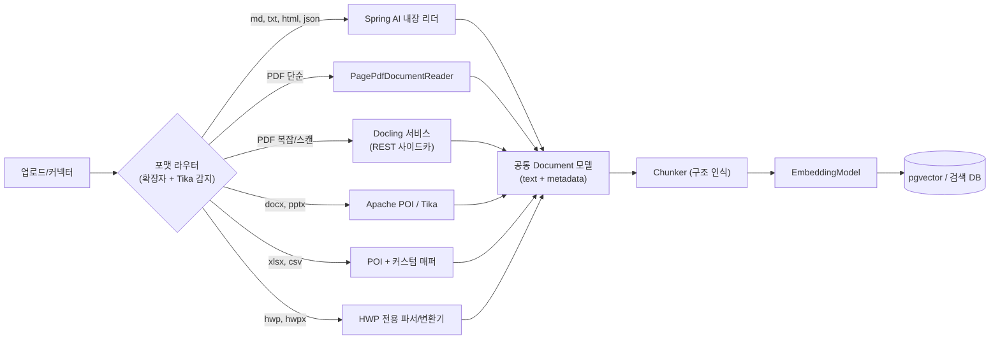

# 사내 RAG에 들어가는 데이터 타입과 파서 선택 (Spring AI 기준)

## 쉬운 설명

사내 RAG는 "회사 자료를 읽어 주는 똑똑한 사서"다. 자료는 **글(문서), 표(엑셀), 대화(메신저), 사진/그림(스캔본)** 등 모양이 제각각이다. 그래서 모양마다 **맞는 돋보기(파서)** 가 따로 필요하다. 만능 돋보기 하나로는 표가 뭉개지거나 그림 속 글씨를 놓친다.

## 일반 설명

### 1. 사내 RAG에 보통 들어가는 데이터

| 분류 | 예시 | 형식 | 난이도 |
|---|---|---|---|
| **규정/정책/매뉴얼** | 취업규칙, 보안 정책, 업무 가이드 | PDF, DOCX, **HWP/HWPX**, xlsx | 중~상 (표·번호 계층) |
| **위키/지식베이스** | Confluence, Notion, SharePoint, GitBook | HTML, Markdown, API | 하 |
| **기술 문서/코드** | README, API 문서, ADR, 코드 주석 | Markdown, 코드 | 하 |
| **협업 커뮤니케이션** | Slack/Teams 메시지, 이메일 | JSON(API), EML/MSG | 중 (스레드·노이즈) |
| **티켓/이슈** | Jira, 헬프데스크, 장애 리포트 | JSON(API) | 중 |
| **표 데이터** | 엑셀 규정집, FAQ 시트, CSV | xlsx, csv | 중 (병합 셀·계층) |
| **프레젠테이션** | 제안서, 교육자료 | PPTX, PDF | 상 (그림 위주) |
| **회의/통화** | 회의록, 녹취 | VTT, 오디오 ([관련](audio-to-text-rag-ingestion-managed-options.md)) | 중 |
| **스캔 문서/이미지** | 계약서 스캔, 영수증, 도면 | 이미지 PDF, PNG/JPG | 상 (OCR 필요) |
| **DB/정형 데이터** | 제품 카탈로그, 고객 FAQ | RDB 테이블 | 하 (보통 SQL/텍스트 변환) |

현실적 우선순위: **PDF, DOCX, HWP, 위키(HTML/MD), xlsx**가 대부분이다. 처음에는 "가장 많이 질문되는 소스 1~2개"로 시작한다.

### 2. Spring AI가 제공하는 `DocumentReader`

Spring AI ETL은 `DocumentReader → DocumentTransformer → DocumentWriter`다. 기본 제공 리더는 다음과 같다(검색된 문서 기준).

| 리더 | 대상 | 비고 |
|---|---|---|
| `TextReader` | .txt, .md (UTF-8) | 단순 텍스트 |
| `MarkdownDocumentReader` | Markdown | 헤더/구분 기준 분리 옵션 |
| `JsonReader` | JSON | JSONPath로 필드 추출. API 응답(티켓, 메시지)에 유용 |
| `JsoupDocumentReader` | HTML | 위키/웹 페이지, CSS 셀렉터 |
| `PagePdfDocumentReader` | PDF (PDFBox) | 페이지 단위 Document |
| `ParagraphPdfDocumentReader` | PDF | 목차(TOC) 기반 문단 단위. 목차 없는 PDF는 부적합 |
| `TikaDocumentReader` | PDF, DOC(X), PPT(X), HTML 등 광범위 | 텍스트 추출 위주, **표 구조 보존이 약함** |

공통 한계: 이 리더들은 **텍스트 추출기**다. 표, 다단 레이아웃, 스캔 이미지, 차트에 약하다.

### 3. 포맷별 파서 추천

| 포맷 | 1순위 | 보조/대안 | 이유 |
|---|---|---|---|
| **Markdown, TXT** | `MarkdownDocumentReader`, `TextReader` | - | 이미 구조화 |
| **HTML(위키)** | `JsoupDocumentReader` 또는 원본 API로 직접 수집 | Confluence/Notion API → Markdown | 네비게이션·광고 노이즈 제거 |
| **JSON(티켓/채팅)** | `JsonReader` + 직접 변환 | - | 스레드 단위로 묶는 규칙이 품질 좌우 |
| **텍스트형 PDF (표 적음)** | `PagePdfDocumentReader` | `TikaDocumentReader` | 가볍고 JVM 내에서 완결 |
| **표/레이아웃 복잡한 PDF** | **Docling**(사이드카 서비스) | LlamaParse(관리형), Unstructured | 표를 Markdown/구조로 복원. 검색된 비교글에서 복잡한 표 정확도가 높다고 평가(97.9% 등은 벤더/블로그 수치라 자체 검증 필요), 처리 속도는 느림 |
| **DOCX** | `TikaDocumentReader` 또는 **Apache POI(XWPF)** | Docling | 헤딩 스타일을 보존하려면 POI로 직접 구조 추출 |
| **PPTX** | Tika 또는 POI(XSLF) | PDF 변환 후 Docling | 슬라이드 단위 청킹, 이미지 내 텍스트는 별도 처리 |
| **xlsx/csv** | **Apache POI + 직접 매핑/청킹** | - | `TikaDocumentReader`는 표 구조 손실 ([상세 설계](rag-internal-policy-xlsx-ingestion-design.md)) |
| **HWP/HWPX** | 전용 파서 (아래) | HWP→PDF/DOCX 변환 후 처리 | 표준 파서가 HWP 미지원 |
| **스캔 PDF/이미지** | OCR 포함 파서(Docling OCR, Azure Document Intelligence, Clova OCR 등) | Tesseract | 텍스트 레이어가 없어 OCR 필수 |
| **EML/MSG** | Tika 또는 Jakarta Mail | - | 헤더/본문/첨부 분리 후 첨부는 재귀 파싱 |

**HWP 참고**: Docling, Unstructured, LlamaParse는 HWP를 기본 지원하지 않는다는 것이 검색된 자료의 내용이다. 한국 사내 문서에서는 비중이 커서 별도 대응이 필요하다.
- 전용 오픈소스(검색 확인): `dochan`(HWP/HWPX → Markdown/JSON/텍스트), `kordoc`(HWP/HWPX/PDF). 둘 다 비(非)JVM이므로 사이드카로 운영하거나 변환 단계로 쓴다.
- JVM 직접 처리는 `hwplib` 계열 라이브러리가 일반적으로 알려져 있으나 이번 검색에서 확인하지 못했으므로 도입 전 유지보수 상태와 라이선스를 확인한다.
- 실무적으로는 **HWP → PDF 변환(한컴 오피스/LibreOffice 등) → PDF 파서** 경로가 가장 안전한 경우가 많다. 단, 변환 품질 검증이 필요하다.

### 4. Spring AI 구조에서의 권장 설계

Spring AI 기본 리더를 그대로 엮기보다 **자체 `DocumentParser` 포트 + 포맷별 어댑터**를 둔다.

- 모든 리더 출력을 **동일한 `Document`(text + metadata)** 로 정규화한다. 이후 단계는 포맷을 모른다.
- **복잡한 파서(Docling 등)는 Java 프로세스 밖 별도 서비스**로 두고 REST로 호출하는 구성이 흔하다. JVM 내부에서 Python 의존성을 다루지 않아도 된다.
- 포맷 판별은 확장자만 믿지 말고 Tika의 MIME 감지를 병행한다.
- 파싱 실패/품질 저하 문서를 **격리하고 재처리**할 수 있는 ingestion job 상태를 둔다.

### 5. 파서보다 중요한 것: 메타데이터와 청킹

파서 선택만큼 아래가 검색 품질을 좌우한다.

| 항목 | 내용 |
|---|---|
| **구조 인식 청킹** | 고정 길이로 자르지 말고 헤딩/조항/슬라이드/스레드 같은 **의미 경계**로 자른다. 표는 쪼개지 않고, 쪼갤 땐 헤더 행을 반복한다 |
| **계층 경로(breadcrumb)** | "제3장 > 제12조 > ②항"을 청크 앞에 붙여 맥락 유지 |
| **메타데이터** | 출처 URL/파일, 문서 ID, 버전, 시행일/수정일, 작성 부서, 언어, 페이지·섹션 |
| **권한(ACL)** | 문서별 접근 권한을 청크에 상속시키고 **검색 시 필터링**. 사내 RAG의 가장 중요한 보안 요소 |
| **중복·개정 관리** | 파일 해시, 버전 컬럼. 최신본만 검색하도록 하고 이전 버전은 보관 또는 비활성 |
| **원문 링크** | 답변에 출처 인용(페이지/섹션)을 제공할 수 있게 위치 정보를 보존 |

### 6. 단계적 도입 순서

1. **대상 소스 1~2개 선정**(예: 규정 PDF + 위키) → `Page/Tika/Jsoup` 리더로 PoC.
2. 질문 100개 정도의 **평가 세트**를 만들어 검색 적중률을 측정(파서를 바꿔 가며 비교).
3. **표/스캔/HWP에서 품질이 낮은 파일만** 전용 파서(Docling, HWP 파서, OCR)로 승격.
4. 커넥터(Confluence, SharePoint, Slack 등)와 증분 동기화, ACL 필터 추가.

### 7. 주의

- 파서 정확도 수치(Docling 97.9% 등)는 비교 블로그 출처이며 데이터셋에 따라 크게 달라진다. **자사 문서 샘플로 직접 비교**해야 한다.
- Spring AI의 리더·API는 버전별로 변경이 잦으므로 사용 버전의 공식 문서를 확인한다.
- 개인정보·기밀(급여, 인사 정보)이 섞인 문서는 임베딩/LLM 호출 전 **마스킹 또는 제외 정책**을 정한다.

### 출처

- [Spring AI DocumentReader (API 문서)](https://docs.spring.io/spring-ai/docs/1.0.0/api/org/springframework/ai/document/DocumentReader.html)
- [TikaDocumentReader (Spring AI)](https://docs.spring.io/spring-ai/docs/0.7.1-SNAPSHOT/org/springframework/ai/reader/tika/TikaDocumentReader.html)
- [Spring AI ETL 딥러닝 (Paradigma)](https://en.paradigmadigital.com/dev/deep-learning-spring-ai-etl-mcp/)
- [Best document parser: LlamaParse, Unstructured, Reducto (Nutrient)](https://www.nutrient.io/blog/best-document-parser-llamaparse-unstructured-reducto/)
- [Docling vs Unstructured (Keywords AI)](https://keywordsai.co/market-map/compare/docling-vs-unstructured)
- [Best PDF Parsing Tools for RAG (fast.io)](https://www.fast.io/resources/best-pdf-parsing-tools-rag.md)
- [dochan (HWP/HWPX 파서)](https://pypi.org/project/dochan)
- [kordoc (한국 문서 파서)](https://www.sourcepulse.org/projects/27164665)
- 관련 문서: [사내 규정 xlsx 인제스트 설계](rag-internal-policy-xlsx-ingestion-design.md)
