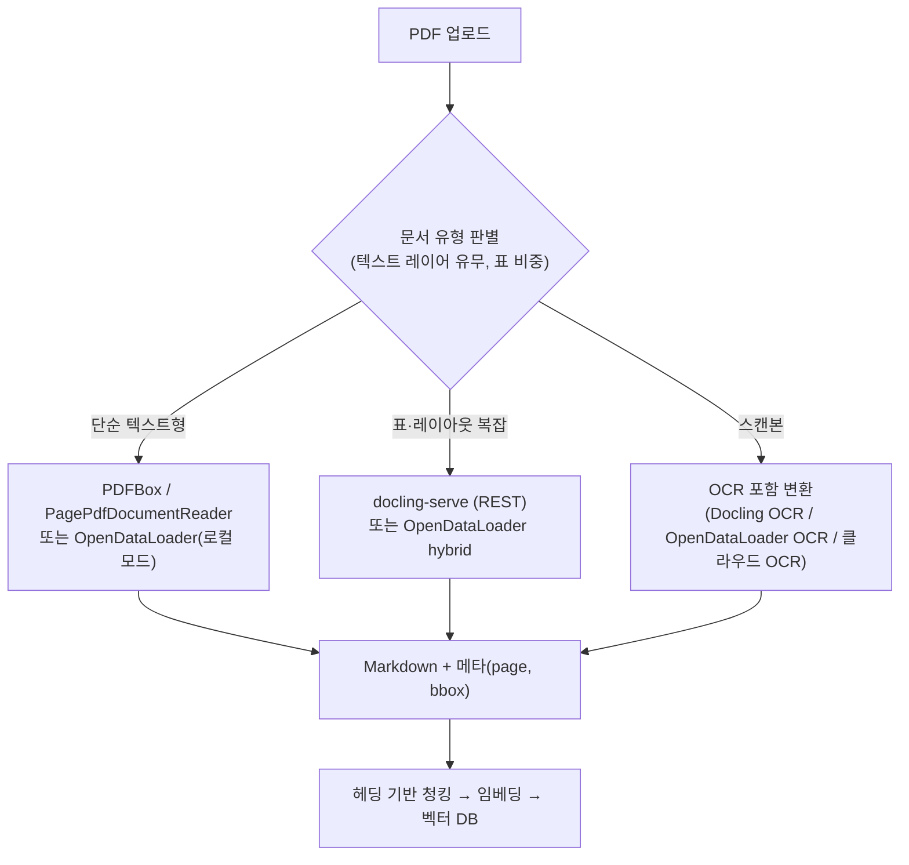

# PDF → Markdown 변환: RAG에 좋은 방법인가, Java 생태계는?

## 쉬운 설명

PDF는 **사진처럼 찍어 둔 글**이다. 글자가 "어느 위치에 있다"만 알고 "여기가 제목, 여기가 표"라는 건 모른다. Markdown은 "이건 제목, 이건 표"라고 **표시를 달아 준 글**이다. 그래서 AI가 읽기 좋다. 다만 표시를 잘 달아 주는 **도우미(변환기)** 를 잘 골라야 하고, 자바 쪽 도우미는 파이썬보다 아직 적은 편이다.

## 일반 설명

### 1. 결론

- **PDF → Markdown은 나쁜 방법이 아니라 RAG에서 가장 흔한 방법이다.** 헤딩·목록·표가 마크다운 문법으로 남으면 구조 인식 청킹이 쉬워지고 LLM도 잘 이해한다.
- 품질은 **변환기에 달렸다.** 단순 텍스트 추출(PDFBox)은 읽기 순서·표가 깨지고, 레이아웃 분석 모델 기반 변환기는 훨씬 낫지만 느리다.
- **Java 생태계는 Python보다 약하다.** 다만 최근 선택지가 생겼고, 현실적으로는 **"Python 변환기를 별도 서비스로 두고 Java에서 REST 호출"** 이 가장 흔하다.

### 2. Markdown 변환의 장단점

| 장점 | 단점/한계 |
|---|---|
| 헤딩 기준 청킹이 쉬움 (`#`, `##` 경계) | 복잡한 표(병합 셀, 중첩)는 마크다운 표로 **표현 자체가 불가**하거나 깨짐 |
| LLM이 마크다운 구조를 잘 이해 | 위치 정보(페이지, bbox) 소실 → **출처 인용(페이지 표시) 어려움** |
| 사람이 결과를 눈으로 검수 가능 | 다단 레이아웃·각주·머리글/바닥글 노이즈가 섞이면 오염 |
| 포맷이 단순해 후처리 쉬움 | 변환 중 **조용한 오류**(순서 뒤섞임, 누락)가 발생해도 알기 어려움 |
| 파서 교체 시에도 출력 형식 통일 | 수식·이미지·차트 정보는 별도 처리 필요 |

**대응 방법**
- **마크다운 + 구조화 JSON(bbox, 페이지)을 함께 얻는 도구**를 쓰면 인용과 검수가 쉬워진다(아래 OpenDataLoader PDF, Docling이 해당).
- 복잡한 표는 마크다운 대신 **HTML 표나 JSON으로 보존**하거나, 표 전체를 통째로 한 청크로 두고 설명 요약을 함께 임베딩한다.
- 청크 메타데이터에 `page`, `section path`를 저장한다.

### 3. 변환 도구 비교

#### Python/기타 생태계 (사이드카 서비스로 사용)

| 도구 | 특징 | 비고 |
|---|---|---|
| **Docling** (IBM) | 레이아웃(DocLayNet)+표 구조(TableFormer) 모델, 구조화 `DoclingDocument` 출력, `docling-serve` REST 제공 | 정확도 높지만 느림. 오픈소스 |
| **Marker** | 빠름, Surya OCR, `--use_llm` 옵션으로 정확도 상승 | GPU/CPU/MPS. 라이선스 조건 확인 필요 |
| **MinerU** | 중국어·일본어·한국어, 과학 문서, 수식에 강점 | 검색 자료 기준 CJK 문서에 적합하다고 평가 |
| **PyMuPDF4LLM** | 가볍고 빠름 | 라이선스(AGPL 계열 가능성) 확인 필요 |
| **LlamaParse / Reducto** (관리형) | 복잡한 표·슬라이드에 강점 | 문서가 외부로 전송됨 |

#### Java 생태계

| 도구 | 특징 | 평가 |
|---|---|---|
| **OpenDataLoader PDF** | **Java 라이브러리(Apache 2.0)**, Markdown/JSON/HTML 출력, 요소별 bbox, 읽기 순서(XY-Cut++), 표 감지, OCR(80+ 언어, hybrid 모드). 로컬 결정론적 모드 약 0.015초/페이지, AI hybrid 모드 약 0.46초/페이지. Python/Node/Java SDK | **Java에서 가장 유망한 신규 선택지.** 단, 벤치마크(0.907)는 프로젝트 자체 주장이므로 한국어 문서로 검증 필요. LangChain/Haystack 연동 존재 |
| **docling-java** (`docling-serve-client`) | Docling 서버(`docling-serve`)를 REST로 호출하는 공식 Java 클라이언트. JDK `HttpClient` + Jackson 기반. LangChain4j `DocumentParser` 연동, Spring Boot용 Arconia 통합 존재 | **정확도 우선 시 현실적.** 별도로 docling-serve를 운영해야 함 |
| **Apache PDFBox** | 텍스트 추출·좌표 접근. Spring AI `PagePdfDocumentReader`의 기반 | 마크다운 변환은 직접 구현해야 함. 텍스트형 단순 PDF에 적합 |
| **tabula-java** (+PDFBox) | 선(ruling)이 있는 표 추출 → CSV/구조 | 표 보조용. 전체 문서 변환기는 아님 |
| **Nutrient(구 PSPDFKit) 등 상용 SDK** | Java용 PDF→Markdown 가이드 제공 | 상용 라이선스 비용 |
| **iText** | 강력한 PDF 라이브러리 | 마크다운 변환 전용 기능은 확인하지 못함. 라이선스(AGPL/상용) 주의 |

### 4. 추천 구성

| 상황 | 선택 |
|---|---|
| JVM만 쓰고 싶고 문서가 비교적 단순 | **OpenDataLoader PDF(로컬 모드)** 또는 PDFBox |
| 표·복잡 레이아웃이 많고 정확도 우선 | **Docling(docling-serve) + docling-java 클라이언트** |
| 한국어 문서·CJK 중심 | MinerU 또는 Docling을 샘플로 비교 |
| 외부 반출 불가 | 위 오픈소스를 사내 서버에서 운영 |
| 운영 부담 최소, 반출 가능 | LlamaParse 등 관리형 |

### 5. 선택 전 검증 방법

1. **대표 PDF 10~20개**(표 많은 것, 스캔본, 다단, 한국어 규정집 등)를 고른다.
2. 후보 도구 2~3개로 변환해 **눈으로 비교**: 읽기 순서, 표, 헤딩 계층, 머리글/바닥글 노이즈, 한글 깨짐.
3. 표 질문·본문 질문 각각 **검색 적중률**을 비교한다(파서를 바꿔 가며 같은 질문 세트로).
4. 속도·메모리·운영 난이도(JVM 단독 vs 사이드카)를 함께 본다.

### 6. 주의

- 정확도·속도 수치(0.907, 0.015초/페이지 등)는 **프로젝트/블로그의 자체 주장**이며 한국어 문서 기준이 아니다. 직접 검증이 필요하다.
- OpenDataLoader PDF는 비교적 신생 프로젝트라 안정성, 한국어 OCR 품질, 유지보수 현황을 도입 전 확인한다.
- Marker, PyMuPDF4LLM, iText 등은 **라이선스 조건**이 사내 사용에 영향을 줄 수 있으니 확인한다.
- HWP는 이들 도구가 지원하지 않는다 ([데이터 타입별 파서 문서](internal-rag-data-types-and-parsers-spring-ai.md) 참고).

### 출처

- [OpenDataLoader PDF (RAG Frameworks)](https://dev.co/ai/rag/opendataloader-pdf)
- [OpenDataLoader PDF - LangChain 연동](https://docs.langchain.com/oss/python/integrations/document_loaders/opendataloader_pdf.md)
- [Haystack OpenDataLoaderConverter](https://docs.haystack.deepset.ai/docs/opendataloaderconverter)
- [Docling Java](https://docling-project.github.io/docling-java/current/)
- [Docling Serve Client (docling-java)](https://docling-project.github.io/docling-java/0.7.1/docling-serve/serve-client/)
- [LangChain4j Docling 연동](https://docs.langchain4j.dev/integrations/document-parsers/docling)
- [PDF to Markdown in Java (Nutrient)](https://www.nutrient.io/guides/java/conversion/pdf-to-markdown/)
- [Best Open-Source PDF-to-Markdown Tools in 2026](https://themenonlab.blog/blog/best-open-source-pdf-to-markdown-tools-2026)
- [From PDFs to Markdown: Evaluating Document Parsers for Air-Gapped RAG](https://dev.to/ashokan/from-pdfs-to-markdown-evaluating-document-parsers-for-air-gapped-rag-systems-58eh)
- [Docling vs MinerU](https://www.file2markdown.ai/blog/docling-vs-mineru)
