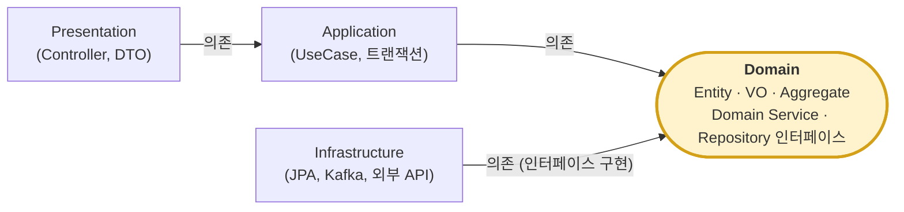
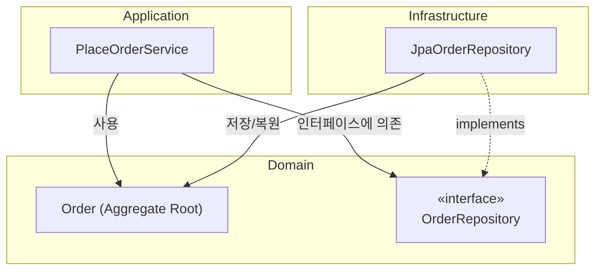
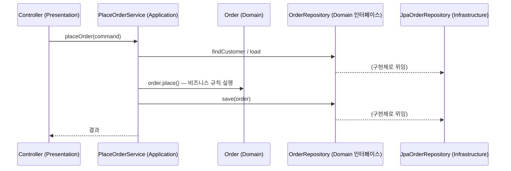

# DDD(도메인 주도 설계): 주요 구성요소와 핵심 규칙

## 쉬운 설명

DDD는 "**장난감 가게의 말(용어)을 코드에도 그대로 쓰자**"는 약속이다. 가게 사람들이 "주문", "배송"이라고 부르면 코드에도 `Order`, `Delivery`가 있어야 한다. 그리고 가게를 "장난감 코너", "계산대 코너"처럼 구역별로 나누고, 구역마다 자기 규칙을 스스로 지키게 한다.

## 일반 설명

DDD(Eric Evans, 2003)는 **복잡한 비즈니스 도메인을 모델링의 중심**에 두는 설계 방법론이다. "아키텍처"라기보다 **설계 철학 + 패턴 모음**이다. 헥사고날/클린 아키텍처와 자주 함께 쓰이며, 이름 컨벤션은 [DDD/헥사고날 이름 컨벤션](ddd-hexagonal-naming-convention.md) 문서를 참고한다.

DDD는 두 층으로 나뉜다.

| 구분 | 다루는 것 | 질문 |
|---|---|---|
| **전략적 설계 (Strategic)** | 시스템 전체의 경계와 관계 | "어디서 나누고 어떻게 협력하나?" |
| **전술적 설계 (Tactical)** | 한 경계 안의 구현 패턴 | "코드로 어떻게 표현하나?" |

### 1. 전략적 설계 구성요소

| 요소 | 설명 |
|---|---|
| **유비쿼터스 언어 (Ubiquitous Language)** | 개발자·도메인 전문가가 공유하는 단일 용어 체계. 코드, 문서, 대화에 동일하게 쓴다 |
| **도메인 / 서브도메인** | 비즈니스 영역. **Core**(경쟁력, 가장 투자할 곳) / **Supporting**(필요하지만 차별성 낮음) / **Generic**(인증·결제 등 범용, 구매·SaaS 고려)로 분류 |
| **바운디드 컨텍스트 (Bounded Context)** | 특정 모델과 용어가 일관되게 유효한 경계. 같은 단어(예: `Customer`)도 컨텍스트마다 의미가 다를 수 있다. 마이크로서비스 경계의 후보 |
| **컨텍스트 맵 (Context Map)** | 컨텍스트 간 관계 지도 |
| **컨텍스트 간 관계 패턴** | Shared Kernel, Customer-Supplier, Conformist, **Anti-Corruption Layer(ACL, 외부 모델 오염 방지 번역층)**, Open Host Service, Published Language, Separate Ways |

### 2. 전술적 설계 구성요소

| 요소 | 설명 | 예 |
|---|---|---|
| **엔티티 (Entity)** | 고유 식별자와 생명주기가 있는 객체. 속성이 바뀌어도 같은 객체 | `Order`, `User` |
| **값 객체 (Value Object)** | 속성 값으로만 동등성을 판단, **불변(immutable)**, 식별자 없음 | `Money`, `Address`, `Period` |
| **애그리거트 (Aggregate)** | 하나의 일관성·트랜잭션 단위로 묶인 엔티티/VO 클러스터 | `Order` + `OrderLine` |
| **애그리거트 루트 (Aggregate Root)** | 애그리거트의 유일한 진입점. 외부는 루트만 참조 | `Order` |
| **리포지토리 (Repository)** | 애그리거트 저장/조회를 컬렉션처럼 추상화. 인터페이스는 도메인, 구현은 인프라 | `OrderRepository` |
| **도메인 서비스 (Domain Service)** | 특정 엔티티에 속하기 어려운 도메인 로직(상태 없음) | `TransferService`, `PricingPolicy` |
| **도메인 이벤트 (Domain Event)** | 도메인에서 일어난 의미 있는 사실(과거형) | `OrderPlaced`, `PaymentCompleted` |
| **팩토리 (Factory)** | 복잡한 객체/애그리거트 생성 캡슐화 | `OrderFactory` |
| **애플리케이션 서비스** | 유스케이스 조율(트랜잭션, 권한, 호출 순서). **비즈니스 규칙은 갖지 않음** | `PlaceOrderService` |

### 3. 레이어 구조와 의존 규칙

**① 소스 코드 의존 방향 (화살표 = "~를 import/참조한다")**



Domain으로 화살표가 모이고, **Domain에서 나가는 화살표는 없다**. 이것이 DDD 레이어 구조의 핵심이다.

**② 왜 Infrastructure가 Domain을 향하나 (의존성 역전, DIP)**



- 호출 흐름(런타임)은 `Service → JpaOrderRepository → DB`지만, **소스 의존성은 `JpaOrderRepository → OrderRepository(Domain)`로 역전**된다.
- 그래서 DB·프레임워크를 바꿔도 Domain과 Application 코드는 수정하지 않는다.

**③ 런타임 호출 흐름 (요청 1건)**



Application은 **조율만** 하고 규칙 판단은 `Order`가 한다. 의존 방향(①②)과 호출 흐름(③)은 서로 다르다는 점이 헷갈리는 포인트다.

| 레이어 | 역할 |
|---|---|
| Presentation | 요청 수신, DTO 변환, 응답 |
| Application | 유스케이스 조율, 트랜잭션 경계. 얇게 유지 |
| **Domain** | 비즈니스 개념과 규칙. 모델의 심장 |
| Infrastructure | DB, 메시징, 외부 API 등 기술 구현 |

- **핵심 규칙: Domain은 다른 레이어(특히 프레임워크·DB)를 모른다.** 의존성은 안쪽(Domain)을 향한다.
- 리포지토리 같은 인터페이스는 Domain에 두고 구현은 Infrastructure에 둔다 (**의존성 역전, DIP**).

### 4. 핵심 규칙 (실무에서 가장 중요한 것)

1. **유비쿼터스 언어를 코드에 그대로 반영**한다. `Status` 같은 모호한 이름보다 `OrderStatus.SHIPPED`처럼 도메인 용어를 쓴다.
2. **바운디드 컨텍스트별로 모델을 분리**한다. 하나의 거대한 공용 모델(`God Model`)을 만들지 않는다.
3. **애그리거트 경계 안에서만 강한 일관성(트랜잭션)을 보장**한다.
   - 외부는 **루트를 통해서만** 내부 객체에 접근한다.
   - **한 트랜잭션에서는 한 애그리거트만 수정**하는 것이 원칙이다.
   - 애그리거트 간 일관성은 **도메인 이벤트 기반 결과적 일관성(eventual consistency)**으로 맞춘다.
4. **다른 애그리거트는 객체 참조 대신 ID로 참조**한다. 결합도가 낮아지고 경계가 명확해진다.
5. **애그리거트는 작게** 설계한다. 거대한 애그리거트는 락 경합과 성능 문제를 부른다.
6. **리포지토리는 애그리거트 루트 단위**로만 만든다. 내부 엔티티용 리포지토리는 만들지 않는다.
7. **비즈니스 로직은 도메인 객체 안에** 둔다. 로직이 서비스로 새어 나가 엔티티가 getter/setter만 가진 **빈약한 도메인 모델(Anemic Domain Model)**이 되는 것은 대표적 안티패턴이다.
8. **값 객체는 불변**으로 만들고, 가능하면 원시값 대신 VO로 감싼다(`String email` → `Email`). 생성 시점에 유효성을 검증해 항상 유효한 상태를 유지한다.
9. **불변식(Invariant)은 애그리거트가 스스로 지킨다.** 외부에서 상태를 임의로 바꾸지 못하게 하고, 의미 있는 행위 메서드(`order.cancel()`)를 제공한다.
10. **외부 시스템 모델은 ACL로 번역**해서 내 도메인 모델을 오염시키지 않는다.
11. **Domain 레이어에 프레임워크·영속성 어노테이션 의존을 최소화**한다. (JPA를 쓰는 현실적 타협은 가능하나 의식하고 선택한다.)

### 5. 예시 (주문)

```
Order (Aggregate Root, Entity)
 ├─ OrderLine (Entity)          ← 외부 직접 접근 금지
 ├─ Money, Address (Value Object)
 └─ customerId (다른 애그리거트는 ID로만 참조)

order.place()  →  OrderPlaced(Domain Event) 발행
                    └→ 결제/재고 컨텍스트가 구독해 각자 처리 (결과적 일관성)
```

### 6. 언제 쓰고 언제 피하나

| 적합 | 부적합 |
|---|---|
| 규칙이 복잡하고 도메인 전문가와 협업이 필요한 시스템 | 단순 CRUD, 규칙이 거의 없는 관리 도구 |
| 장기 운영, 팀 규모가 큰 시스템 | 소규모 프로토타입/일회성 도구 |

- 전체에 일괄 적용하기보다 **Core 서브도메인에만 집중 적용**하고, 나머지는 단순 구조로 두는 것이 일반적이다.
- 흔한 실패: 패턴 이름만 따라 쓰고(엔티티·리포지토리 껍데기) 유비쿼터스 언어와 컨텍스트 경계 정립은 생략하는 것.

### 출처

- [Domain-Driven Design 개요 (ProcessOn)](https://www.processon.io/blog/domain-driven-design)
- [How to Layer Code with DDD: Four-Layer Architecture, DIP & Hexagonal](https://www.besthub.dev/articles/how-to-layer-code-with-ddd-four-layer-architecture-dip-hexagonal-25f3958c8973)
- [Layers, Onions, Ports, Adapters: it's all the same (Mark Seemann)](https://blog.ploeh.dk/page57)
- [Intro to Domain-Driven Design (SlideShare)](https://www.slideshare.net/slideshow/intro-to-domain-driven-design/239801916)
- [Domain Driven Design (Buzzvil, SpeakerDeck)](https://speakerdeck.com/buzzvil/domain-driven-design)
- Eric Evans, *Domain-Driven Design* (2003) 및 Vaughn Vernon의 애그리거트 설계 규칙(일반 지식 기반, 위 검색 결과로 직접 확인되지 않은 항목 포함)
