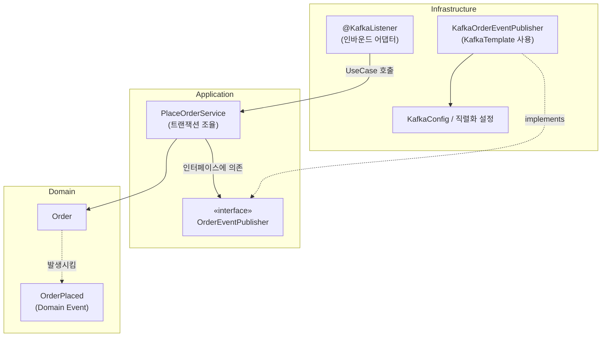

# DDD에서 Kafka는 어디에 구현하나: Infrastructure는 config만이 아니다

## 쉬운 설명

Application은 "택배 보내줘"라고 **주문서(인터페이스)** 만 쓴다. 실제로 택배 기사님(Kafka 클라이언트)이 짐을 싣고 가는 일은 **택배 회사(Infrastructure)** 가 한다. 택배 회사가 설정(config)만 하는 게 아니라 **실제 배달 일(코드)** 도 한다. Application은 기사님이 누구인지 몰라도 된다.

## 일반 설명

### 1. 결론

- **Infrastructure는 config만이 아니다.** 외부 기술을 실제로 다루는 **구현 코드(어댑터)** 가 들어간다. Kafka 프로듀서/컨슈머 코드, JPA 리포지토리 구현, 외부 API 클라이언트가 모두 여기에 속한다.
- **Application은 Kafka를 직접 쓰지 않는다.** `KafkaTemplate`, `ProducerRecord` 같은 Kafka 타입을 import하지 않고, **"메시지를 발행한다"는 의도를 표현한 포트(인터페이스)** 에만 의존한다.
- 인터페이스(포트)는 **Application 또는 Domain**에, 구현(어댑터)은 **Infrastructure**에 둔다. 이것이 의존성 역전(DIP)이다.

### 2. 역할 분담

| 위치 | 담는 것 | 예 |
|---|---|---|
| **Domain** | 도메인 이벤트 정의(사실 자체) | `OrderPlaced` (Kafka를 모름) |
| **Application** | 발행 **포트(인터페이스)**, 유스케이스·트랜잭션 조율 | `OrderEventPublisher` 인터페이스, `PlaceOrderService` |
| **Infrastructure** | 포트의 **구현**, Kafka 설정, 직렬화, 토픽/키 결정, 재시도, 컨슈머 | `KafkaOrderEventPublisher`, `KafkaConfig`, `@KafkaListener` |

`config`는 Infrastructure의 일부일 뿐이고, 실제 `KafkaTemplate.send()` 호출 같은 **서비스 코드도 Infrastructure**에 있다.

### 3. 구조 (mermaid)



- **아웃바운드(발행)**: Application → 포트 ← Kafka 어댑터.
- **인바운드(구독)**: `@KafkaListener`는 Presentation의 Controller와 같은 **인바운드 어댑터**다. 메시지를 받아 DTO/Command로 변환한 뒤 유스케이스를 호출한다. 비즈니스 로직은 넣지 않는다.

### 4. 코드 예시 (Java/Spring)

```java
// application: 포트 (Kafka를 모른다)
public interface OrderEventPublisher {
    void publish(OrderPlaced event);
}

// application: 유스케이스
@Service
class PlaceOrderService {
    private final OrderRepository orders;
    private final OrderEventPublisher publisher;

    @Transactional
    public void placeOrder(PlaceOrderCommand cmd) {
        Order order = Order.place(cmd.customerId(), cmd.lines()); // 규칙은 도메인에
        orders.save(order);
        publisher.publish(new OrderPlaced(order.getId()));        // 의도만 표현
    }
}

// infrastructure: 어댑터 (Kafka 세부 사항은 여기에만)
@Component
class KafkaOrderEventPublisher implements OrderEventPublisher {
    private final KafkaTemplate<String, String> kafka;

    public void publish(OrderPlaced e) {
        kafka.send("order.placed", e.orderId().toString(), serialize(e));
    }
}
```

### 5. 트랜잭션 내/외부 발행 문제

질문의 "트랜잭션 내/외부에서 Kafka를 쓴다"는 부분이다. **DB 커밋과 Kafka 전송은 하나의 트랜잭션으로 묶이지 않는다**(DB 트랜잭션과 브로커는 별개). 그래서 전략을 선택해야 한다.

| 방식 | 동작 | 장단점 |
|---|---|---|
| **트랜잭션 안에서 직접 send** | 커밋 전 전송 | 롤백돼도 메시지는 이미 나감(유령 이벤트). **비권장** |
| **AFTER_COMMIT 발행** | `@TransactionalEventListener(phase = AFTER_COMMIT)`로 커밋 성공 후 전송 | 간단. 단, 커밋 후 전송 직전에 서버가 죽으면 **이벤트 유실** 가능 |
| **Transactional Outbox** | 비즈니스 데이터와 같은 트랜잭션으로 outbox 테이블에 저장, 별도 릴레이(폴링/CDC)가 Kafka로 전송 | 유실 방지(at-least-once). 컨슈머 멱등성 필요. **신뢰성이 중요하면 표준 선택** |

- 검색된 자료 기준 outbox에서 Spring `@TransactionalEventListener`를 쓸 때는 `BEFORE_COMMIT`을 써야 outbox 기록이 같은 트랜잭션에 묶인다. `AFTER_COMMIT`은 별개 전략이다.
- 어느 전략이든 **Application은 `publisher.publish()`만 호출**하고, 즉시 전송인지 outbox 적재인지는 **Infrastructure 어댑터 구현이 결정**한다. 구현체를 `KafkaOrderEventPublisher`에서 `OutboxOrderEventPublisher`로 바꿔도 Application 코드는 변하지 않는다.
- 도메인 이벤트 방식을 쓰면 애그리거트가 이벤트를 모으고(`registerEvent`), Application 서비스가 저장 후 디스패치하는 구조도 흔하다(Spring Data의 `AbstractAggregateRoot` 등).

### 6. 실용적 타협

| 쟁점 | 현실 |
|---|---|
| 포트를 Application에 둘지 Domain에 둘지 | 둘 다 통용된다. 도메인 이벤트 자체는 Domain, 발행 포트는 Application이 흔하다 |
| 포트 없이 Application이 `KafkaTemplate` 직접 사용 | 동작은 하지만 Application이 Kafka에 결합되어 테스트(Mock)와 교체가 어렵다. 소규모·단순 시스템에서는 타협하기도 한다 |
| 스프링 `ApplicationEventPublisher` 사용 | 프레임워크 타입이지만 간단한 추상화로 쓰고, Kafka 변환은 리스너(Infrastructure)에서 처리하는 방식도 널리 쓰인다 |

판단 기준은 "**Application 코드에 `org.apache.kafka`나 `KafkaTemplate`이 등장하는가**"다. 등장하지 않으면 레이어 규칙을 지킨 것이다.

### 출처

- [Implementing The Outbox-Pattern With Kafka – Part 1 (juplo)](https://juplo.de/implementing-the-outbox-pattern-with-kafka-part-1-the-outbox-table/)
- [spring-boot-event-driven-patterns](https://skillselion.com/skills/giuseppe-trisciuoglio/developer-kit-claude-code/spring-boot-event-driven-patterns)
- [DDD 4-layer, DIP & Hexagonal](https://www.besthub.dev/articles/how-to-layer-code-with-ddd-four-layer-architecture-dip-hexagonal-25f3958c8973)
- 관련 문서: [DDD 구성요소와 핵심 규칙](ddd-components-and-core-rules.md), [DDD/헥사고날 이름 컨벤션](ddd-hexagonal-naming-convention.md)
